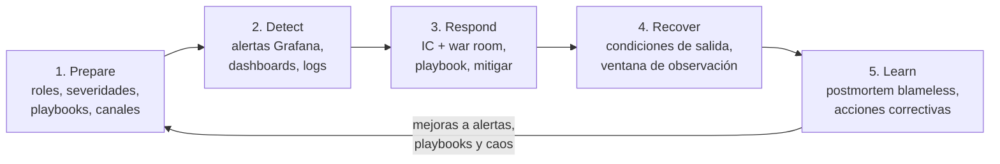
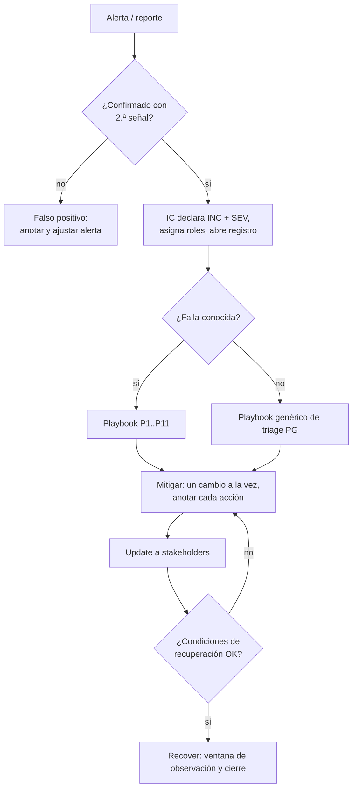

# Plan de contención de incidentes operacionales — PharmaGo

Plan de mitigación de incidentes para PharmaGo, organizado según las cinco fases del ciclo de vida de incidentes de Atlassian: **Prepare → Detect → Respond → Recover → Learn**. Lo usamos durante la guardia y en la defensa (war room).

Un **incidente** es una interrupción del servicio que afecta a los usuarios (las farmacias y sus clientes) y requiere una respuesta inmediata. Un bug que no afecta el servicio en ese momento no es un incidente: va al backlog.

**Alcance.** PharmaGo corre en minikube con 3 nodos, en el namespace `pharmago`. Todos los comandos asumen que el clúster está activo y que `k8s/port-forward.sh` está corriendo.



Rutas. Las de código son relativas a `Implementacion K8S/Codigo/` y las de evidencias a `docs/evidencias/`.

**Versión que describe.** Este plan describe la rama `feature/k8s` **más los cambios que están en el working tree, todavía sin commitear**: las correcciones de alertas del 07/11 y las mejoras del 08/11. Las pruebas se hicieron en tres rondas:

- **Ronda 1, `feature/k8s` tal cual** (19:07 a 19:51, UTC-3). Las alertas no eran confiables: el collector se caía por OOM cada pocos minutos, la base caída podía pasar sin ninguna alerta y la alerta de red daba falsos positivos.
- **Ronda 2, con las correcciones** (22:08 a 23:04). Todas las fallas de los scripts de caos dispararon su alerta, sin falsos positivos en la línea base. Salvo que se diga otra cosa, los tiempos de cada playbook y del Anexo A son de esta ronda.
- **Ronda 3, mejoras** (08/11, 23:12 a 23:35). Se probaron las alertas nuevas (reinicios, evictions y backup) y el backup con restore.

Qué cambian las correcciones del 07/11 (detalle en 5.3):

- El collector trae solo las 15 métricas de cAdvisor y node-exporter que se usan, en vez de unas 15.000 series. Pasó de reiniciarse por OOM cada ~3 minutos a 0 reinicios, con un pico de 142Mi sobre 256Mi.
- El collector manda a Prometheus la hora real de cada muestra (`send_timestamps`) y su ServiceAccount puede hacer `watch` de los nodos.
- Las apps exportan métricas cada 10 s en vez de 60 s.
- Prometheus cuenta como réplica solo a los pods **Ready**.
- Se corrigieron las 8 alertas originales y se agregaron "Escritura a disco alta en pod", "Rate limit activo en el gateway" y "Telemetría caída".

Qué agregan las mejoras del 08/11:

- Jaeger y Kibana prefieren los nodos de backend. Los limits del nodo `minikube` bajaron del 109 % al 80 %.
- kube-state-metrics y tres alertas más: "Pod reiniciado", "Pod desalojado (Evicted)" y "Backup de la base fallido". En total hay **14 alertas**.
- PodDisruptionBudgets `minAvailable: 1` para gateway, users, pharmacy y UI.
- Backup diario de la base con el CronJob `pharmago-db-backup`.

---

## 1. Prepare

> "La calidad de la respuesta depende en gran parte de la preparación previa." El incidente no se puede evitar, pero sí podemos estar preparados.

### 1.1 Servicios críticos

| Prioridad | Componente | Deployment | Por qué es crítico | Redundancia |
| :-: | --- | --- | --- | --- |
| 1 | API Gateway (YARP) | `pharmago-api-gateway` | Es la única entrada al backend. Si se cae, se cae todo. | 2 réplicas en el nodo `minikube` |
| 1 | Base de datos SQL Server | `pharmago-db` | La usan users y pharmacy. Sin base no hay login ni compras. | **1 réplica** (`Recreate`, PVC `sql-pvc`). Es un punto único de falla. Backup diario a las 03:00, se guardan los últimos 7 en `sql-backup-pv` (P11). SQL Server Express no admite réplicas. |
| 2 | Users service | `pharmago-users-service` | Login, usuarios, roles e invitaciones. Pharmacy también lo llama. | 2 réplicas en `minikube-m03` |
| 2 | Pharmacy service | `pharmago-pharmacy-service` | Drogas, compras y pedidos de stock: el negocio de las farmacias. | 2 réplicas en `minikube-m02` |
| 3 | UI (Angular + nginx) | `pharmago-ui` | Frontend. Sin la UI la API sigue funcionando. | 2 réplicas |
| Soporte | Observabilidad | `prometheus`, `grafana`, `otlp-collector`, `elasticsearch`, `kibana`, `fluent-bit`, `jaeger`, `node-exporter`, `kube-state-metrics` | No atienden usuarios, pero sin ellos estamos ciegos durante el incidente. El `otlp-collector` es el punto más delicado: por él pasan las métricas de la app **y** las de cAdvisor y node-exporter. Si se cae, avisa la alerta "Telemetría caída" (ver P10). | 1 réplica (los DaemonSets corren uno por nodo) |
| Soporte | Nodo `minikube` (control plane) | — | Corre el apiserver y además la base, el gateway, la UI, Elasticsearch, Prometheus, Grafana y el collector. Si se queda sin memoria, cae todo (ver P10). | Ninguna |

La ubicación de los pods sale de `k8s/deployments/backend/*.yaml` y `k8s/deployments/ops/*.yaml`. Cada microservicio de backend tiene su propio nodo por antiafinidad de `tier: backend`, y sus réplicas van juntas en ese nodo por `podAffinity`. La base, el gateway, la UI y la mayor parte de la observabilidad van al nodo `minikube` (`node-type=all`). Jaeger, Kibana y kube-state-metrics **prefieren** los nodos `backend` (afinidad `preferred`): con 3 nodos caen en m02 o m03, y con uno solo pueden ir a `minikube`.

**Riesgo de capacidad.** El contenedor de cada nodo de minikube tiene 3,9 GiB, pero el nodo le reporta a Kubernetes unos 7,8 GiB. El scheduler cree que sobra memoria. El 07/11 el nodo `minikube` llegó al 99 % de su memoria, el apiserver dejó de responder y el nodo quedó `NotReady` (incidente real, ver P10). Al mover Jaeger y Kibana, los limits del nodo bajaron de 8,6 GiB (109 %) a 6,2 GiB (80 %), y el working set bajó de 3958Mi a unos 3450Mi. El nodo sigue justo: SQL Server crece hasta 1,1 GiB, y el working set volvió a 3750Mi en 20 minutos (ver 5.3).

### 1.2 Niveles de severidad

| Severidad | Criterio (cualquiera alcanza) | Ejemplos con nuestras alertas | Respuesta | Quiénes | Updates |
| --- | --- | --- | --- | --- | --- |
| **SEV1 (crítico)** | Una función de negocio caída para todos: login, compras o la API entera. Pérdida o riesgo de datos. | "Base de datos inaccesible", "Réplica de microservicio caída" con 0 réplicas, gateway sin réplicas, tasa de error mayor al 50 %. Datos borrados o dañados (P11). | Inmediata (en menos de 5 min) | Los 3. Se abre war room. | Cada 5 min (2 en la defensa) |
| **SEV2 (mayor)** | Servicio degradado: lento, con errores parciales o sin redundancia. El usuario lo nota pero puede operar. También quedarnos sin observabilidad. | "Latencia alta en microservicio", "Pico de errores HTTP", "Pod de backend sin tráfico de red", "Réplica de microservicio caída" con 1 réplica viva, "Telemetría caída", "Backup de la base fallido" (no hay impacto, pero se pierde la red de seguridad). | En menos de 15 min | IC + 1 responder | Cada 15 min |
| **SEV3 (menor)** | Riesgo sin impacto visible para el usuario. | "CPU alta en pod", "Memoria alta en pod" o "Escritura a disco alta en pod" sin efecto en latencia ni errores. "Pod reiniciado" o "Pod desalojado (Evicted)" con el reemplazo ya Ready. "Rate limit activo en el gateway" si los usuarios legítimos entran. "Disco del nodo casi lleno" con tendencia lenta. | En horario hábil, mientras tanto se monitorea | 1 persona | Al abrir y al cerrar |

**Escalado.**

- Un SEV2 sube a SEV1 si a los 15 minutos no está mitigado o si el impacto crece.
- Un SEV3 sube a SEV2 si empieza a afectar la latencia o los errores.
- Si el responder no sabe resolverlo solo, lo dice en el canal y el IC suma a otra persona. Escalar es "avisarle al actor pertinente", no a todos.
- El label `severity` de cada alerta (`critical` o `warning`) es la severidad **inicial sugerida**. La severidad final la decide el IC con el impacto real.

### 1.3 Roles

La propuesta sigue a Atlassian. En incidentes importantes, separar los roles es clave.

| Rol | Responsabilidades | Herramientas |
| --- | --- | --- |
| **Incident Commander (IC)** | Declara el incidente y su severidad. Asigna roles y abre el registro. Decide qué playbook se aplica y qué se hace (un cambio a la vez). Comunica a los stakeholders. Declara el cierre. **No ejecuta comandos.** | Discord, registro del incidente |
| **Responder A: métricas** | Mira las alertas y los dashboards de Grafana. Confirma o descarta falsos positivos. Mide el impacto (errores, latencia, réplicas) y avisa cuando se cumplen las condiciones de recuperación. | Grafana, Prometheus |
| **Responder B: logs, trazas y ejecución** | Diagnostica con Kibana, Jaeger y `kubectl` (pods, events, describe). Ejecuta las acciones del playbook que pide el IC y reporta el resultado. | Kibana, Jaeger, kubectl |
| **Stakeholders** | Farmacias usuarias, negocio y, en la defensa, los docentes. Reciben los updates; no participan del diagnóstico. | Canal `#incidentes` |

- **Si falta alguien**, el IC también hace de Responder A. Con una sola persona, esa persona sigue el playbook y avisa por el canal.
- **Guardia.** La rotación es semanal entre los tres integrantes. Quien está de guardia hace el acknowledgment de las alertas y es el IC por defecto. Puede delegar ese rol si es quien más sabe del componente afectado.

### 1.4 Comunicación y war room

- **Canal escrito.** `#incidentes` en el Discord del equipo. Ahí van la declaración, los updates y el cierre. Un hilo por incidente, titulado `INC-AAAAMMDD-NN - <resumen> - SEVx`.
- **War room.** El canal de voz `war-room` de Discord, con pantalla compartida de Grafana. Para SEV1 y SEV2 entran todos los asignados.
- **Reglas del war room.**
  - Lo lidera el IC.
  - Es corto y enfocado: nadie se va hasta que el incidente está mitigado.
  - Todo se basa en hechos (una métrica, un log, una traza). Nada de contrafácticos como "¿qué hubiera pasado si…?".
  - Se hace un cambio a la vez y se anuncia antes de hacerlo.
  - Todo lo que se hace se anota en el registro, porque con adrenalina o sueño "pueden pasar cositas".
- **Plantilla de update** para stakeholders:

```
[INC-20261123-01 | SEV1 | EN CURSO | 14:32]
Impacto: el login falla para todos los usuarios desde las 14:27.
Qué sabemos: la base de datos no responde; los servicios la detectan como Unhealthy.
Qué estamos haciendo: levantando la base (playbook P6).
Próximo update: 14:37 o antes si cambia algo.
```

**Alertas.** Se ven en Grafana, en *Alerting → Alert rules*. El Responder A las mira durante la guardia o la defensa, y cuando una se confirma la avisa en `#incidentes`.

### 1.5 Registro del incidente (template)

Se copia en el hilo del incidente o en un `.md` y se completa **mientras** pasa.

```markdown
# INC-AAAAMMDD-NN — <resumen corto>
- Severidad: SEVx (inicial) → SEVy (final)
- Estado: Detectado | En curso | Mitigado | Resuelto
- IC: <rol/nombre> · Responder A: <…> · Responder B: <…>
- Inicio del impacto: hh:mm:ss · Detección: hh:mm:ss · Ack: hh:mm:ss
- Mitigación: hh:mm:ss · Resolución: hh:mm:ss
- Servicios afectados: <…>
- Playbook aplicado: Px

| Hora | Quién | Hecho / observación | Acción | Resultado |
| --- | --- | --- | --- | --- |
| 14:27:10 | Grafana | Alerta "Base de datos inaccesible" Firing (PharmaGo.UsersService) | — | — |
| 14:27:40 | Resp. A | Confirmado: panel de errores con 503 en /api/login | IC declara SEV1 | — |
| 14:28:05 | Resp. B | `kubectl get deploy pharmago-db` → 0/0 | Escala a 1 réplica | Pod en ContainerCreating |
```

### 1.6 Mecanismos automáticos que ya tenemos

Son la primera línea de contención. El plan cuenta con que funcionen, y en la defensa hay que explicar cuál actúa en cada falla.

| Mecanismo | Configuración | Qué contiene | Evidencia |
| --- | --- | --- | --- |
| 2 réplicas por microservicio | `replicas: 2` en users, pharmacy, gateway y ui | Si se cae un pod, la otra réplica atiende (MTTR Restore de 0 s) | `docs/evidencias/mttr.md` |
| startupProbe | `/health/live`, cada 2 s | Evita que la liveness mate un pod que todavía está arrancando | `mttr.md` |
| readinessProbe | users y pharmacy usan `/health` (incluye la base), cada 2 s, 3 fallas. El gateway usa `/health/live`, 2 fallas. | Saca del Service, en unos 6 s, a un pod que no puede atender | `mttr.md` |
| livenessProbe | `/health/live`, cada 5 s, 3 fallas, `terminationGracePeriodSeconds: 5` | Reinicia un proceso colgado en unos 28 s. **No** incluye la base, así que una base caída no reinicia los pods. | `mttr.md` |
| Rolling update seguro | `maxSurge: 1`, `maxUnavailable: 0`, `preStop` de 10 s | Permite desplegar sin downtime y hacer rollback con `rollout undo` | `zero-downtime-2-replicas.txt` |
| Limits de recursos | 500m de CPU, 384Mi de memoria y 250Mi de ephemeral-storage por contenedor de backend | Un pod con fuga de recursos no puede tumbar el nodo: se lo limita (throttling), se lo mata (OOMKilled) o se lo desaloja (Evicted) | manifests |
| Circuit breaker | YARP, health check pasivo (más del 50 % de fallas) y activo cada 5 s, reactivación a los 15 s | Ante un backend caído responde 503 en milisegundos en lugar de esperar timeouts | `circuit-breaker.md` |
| Rate limit | AspNetCoreRateLimit por IP: login 10/min, 20/s, 300/min y 10000/h | Frena inundaciones de requests con 429 antes de que lleguen al backend | `rate-limit.md` |
| Antiafinidad | Un microservicio de backend por nodo | Un pod ruidoso no afecta a otro microservicio | manifests |
| PodDisruptionBudget | `minAvailable: 1` para gateway, users, pharmacy y UI (`k8s/pdb/`) | Un `kubectl drain` o cualquier desalojo voluntario saca los pods de a uno y nunca deja al servicio en 0. **No** frena un `kubectl scale --replicas=0`, un OOM ni una eviction por recursos. | `kubectl get pdb -n pharmago` |
| Backup de la base | CronJob `pharmago-db-backup`, todos los días a las 03:00 (Montevideo): `BACKUP DATABASE` + `RESTORE VERIFYONLY`, se guardan los últimos 7 | Permite volver a un estado de hasta 24 h antes si se borran o se dañan datos (P11) | `docs/evidencias/mejoras-20261108/` |

### 1.7 Checklist antes de la guardia o la defensa

```bash
cd "Implementacion K8S/Codigo/k8s"
kubectl get nodes -L node-type                 # 3 nodos Ready (minikube=all, m02/m03=backend)
kubectl get pods -n pharmago -o wide           # todo Running y READY 1/1; backend 2 réplicas
kubectl get pvc -n pharmago                    # todos Bound
kubectl get pod -n pharmago -l app=otlp-collector   # Running y sin reinicios recientes (ver P10)
kubectl get configmap grafana-alerting -n pharmago -o yaml | grep -c "uid: pharmago-"   # 14: están las correcciones y las mejoras
kubectl get pdb -n pharmago                    # 4 PDB con ALLOWED DISRUPTIONS 1
kubectl get cronjob pharmago-db-backup -n pharmago   # LAST SCHEDULE de las últimas 24 h
kubectl exec -n pharmago deploy/pharmago-db -- ls -lh /var/opt/mssql/backup   # hay un .bak reciente
bash port-forward.sh                           # abre todos los puertos
```

Si el nodo `minikube` está `NotReady` o `kubectl` responde lento, hay que aplicar P10 **antes** de empezar.

| Herramienta | URL | Qué chequear |
| --- | --- | --- |
| Grafana | http://127.0.0.1:3000 (admin/admin) | *Alerting → Alert rules*: carpeta PharmaGo con 14 reglas, ninguna disparando. "Pod de backend sin tráfico de red", "Pod desalojado (Evicted)" y "Backup de la base fallido" en **Normal (NoData)** es lo esperado: sus consultas solo devuelven algo cuando hay un corte, un pod desalojado o un backup fallido. "Pico de errores HTTP" y "Rate limit activo en el gateway" también quedan en NoData mientras no haya habido ningún error 5xx o 429 desde que arrancaron los pods. Cualquier otra en NoData indica que faltan datos: mirar "Telemetría caída" y P10. Dashboards "PharmaGo - Overview" y "PharmaGo - Infra" con datos. |
| Prometheus | http://127.0.0.1:9090 | *Status → Targets*: users-service, pharmacy-service y api-gateway con 2/2 up; kube-state-metrics y otlp-collector up. |
| Kibana | http://127.0.0.1:5601 | Data view `pharmago-logs-*` con logs de los últimos 5 min |
| Jaeger | http://127.0.0.1:16686 | Aparecen los servicios PharmaGo.ApiGateway, PharmaGo.UsersService y PharmaGo.PharmacyService |
| Gateway | http://127.0.0.1:5000/test-health | 200 |

**Puertos ocupados en la Mac.**

- El 5000 lo usa AirPlay (ControlCenter escucha en `*:5000`). El port-forward igual gana en `127.0.0.1`, pero si no está levantado, las requests de `load-requests.sh` le llegan a AirPlay sin ningún aviso: el script no lo chequea. Antes de correrlo: `curl -s -o /dev/null -w "%{http_code}\n" http://127.0.0.1:5000/health` tiene que dar 200.
- Si otra app usa el 3000, Grafana se levanta en otro puerto: `kubectl port-forward svc/grafana 13000:3000 -n pharmago`.
- Antes de la defensa hay que confirmar que cada URL abre la herramienta correcta.

---

## 2. Detect

El objetivo es bajar el **MTTD**. Cuanto más tarda la detección, más crece el impacto, por ejemplo con reintentos que saturan y fallas en cascada.

### 2.1 Fuentes de señales

1. **Alertas de Grafana**: `k8s/configmaps/grafana-alerting.yaml`, grupo `pharmago-anomalias`, evaluado cada 10 s.
2. **Dashboards**: "PharmaGo - Overview" para la aplicación y "PharmaGo - Infra" para la infraestructura.
3. **Logs**: Kibana, data view `pharmago-logs-*`.
4. **Trazas**: Jaeger.
5. **Kubernetes**: `kubectl get pods -w` y `kubectl get events`. kube-state-metrics le pasa a Prometheus los reinicios, los pods terminados y el resultado de los jobs de backup.
6. **Usuarios**: lo que reportan las farmacias. En la defensa, lo que muestran los docentes.

### 2.2 Alertas y qué falla dispara cada una

Las 14 alertas de `k8s/configmaps/grafana-alerting.yaml`. La columna "Disparo medido" es de la ronda 2 del 07/11 (de la ronda 3 para las tres últimas), contando desde que arranca el script de caos. Entre paréntesis, el valor de la ronda 1 (`feature/k8s` sin correcciones).

| Alerta (título exacto) | Qué mide | Dispara si | `for` | Severidad label | De dónde sale el dato | Fallas que detecta | Disparo medido |
| --- | --- | --- | --- | --- | --- | --- | --- |
| CPU alta en pod | CPU usada / limit de CPU por pod (`irate[1m]`) | > 80 % | 30 s | warning | cAdvisor → collector | P2 | **74 s** (antes 3 min 28 s, después del fin de la falla) |
| Memoria alta en pod | working set / limit de memoria por pod | > 85 % | 30 s | warning | cAdvisor → collector | P3 | **80 s** con 270 MB (antes 2 min 19 s). Con 350 MB el OOM llega antes: avisa "Réplica caída". |
| Disco del nodo casi lleno | uso de `/` o `/var` del nodo | > 85 % | 1 m | critical | node-exporter → collector | P4, solo si se llena el nodo | no disparó (esperado) |
| Escritura a disco alta en pod (**nueva**) | bytes escritos por segundo por pod de backend (`rate[1m]`) | > 1 MB/s | 0 s | warning | cAdvisor → collector | P4 | **27 s** con 200 MB. Con 300 MB, la eviction llega antes (16 s) y no dispara. |
| Pico de errores HTTP | errores **de servidor** (5xx y excepciones) del último minuto, por servicio. No cuenta 4xx. | > 30 | 0 s | warning | app → OTLP → collector | P6, P7 | **47 s** en P6 (antes no disparaba nunca) |
| Rate limit activo en el gateway (**nueva**) | requests con 429 en el gateway en el último minuto | > 60 | 0 s | warning | app → OTLP → collector | P1 | **29 a 31 s** |
| Base de datos inaccesible | `pharmago_health_status` (health check de la base) en users y pharmacy | < 1 | 15 s | critical | app → OTLP → collector | P6 | **52 s** (antes 68 s, o nunca si el collector estaba caído) |
| Réplica de microservicio caída | `up` por servicio, scrapeado directo por Prometheus, **solo de pods Ready** | < 2 | 0 s | critical | Prometheus (directo) | P3 con OOM, P5, P6, P7, P8 | P5 20 s, **P6 26 s** (antes no disparaba), P7 30 s, P3 con OOM 43 s |
| Latencia alta en microservicio | latencia promedio por servicio (`rate[1m]`) | > 1000 ms | 30 s | warning | app → OTLP → collector | P2, P6 | 88 s en P6 (pharmacy) |
| Pod de backend sin tráfico de red | bytes enviados por `eth0` del pod (`irate[1m]`), solo si el pod sigue usando CPU | < 100 B/s | 10 s | critical | cAdvisor → collector | P5 | **51 s**, solo para el pod cortado (antes disparaba todo el tiempo para pods sanos) |
| Telemetría caída (**nueva**) | collector `up` × hay métricas de cAdvisor × hay métricas de la app | < 1 | 30 s | critical | Prometheus + collector | P10 | **48 s** con el collector a 0 réplicas |
| Pod reiniciado (**nueva**) | reinicios de contenedores por pod en los últimos 5 min (`increase`) | > 0,5 | 0 s | warning | kube-state-metrics (directo) | P3 con OOM, P5, P7 | **28 s** con `inject-process-failure.sh users crash`. Sigue firing 5 min después del reinicio. |
| Pod desalojado (Evicted) (**nueva**) | pods de un ReplicaSet en fase `Failed` o `Succeeded` | > 0 | 0 s | warning | kube-state-metrics (directo) | P4 con eviction | **34 s** con 300 MB (13 s después de la eviction). Sigue firing hasta que se borra el pod desalojado. |
| Backup de la base fallido (**nueva**) | inicio del último job de backup fallido − inicio del último job completo | > 0 | 0 s | critical | kube-state-metrics (directo) | P11 | Con la regla final, en la primera evaluación con un job ya `Failed` (no se midió desde que arrancó el job; con la primera versión, 5 min 17 s). Se resuelve con el próximo backup exitoso, programado o manual. |

Todos los resúmenes de las alertas usan `{{ .Labels.pod }}`. Los originales tenían `{{ $$labels.pod }}`, que Grafana no interpreta: daba "bad character U+0024" y la alerta salía sin texto.

**Qué tener en cuenta al leer las alertas.**

- **"Réplica de microservicio caída" es la más rápida y la más amplia.** Cuenta réplicas Ready, así que salta con cualquier cosa que saque un pod del Service: corte de red, base caída, OOM o pods borrados. Dice que algo anda mal, pero no qué. La causa la indica la alerta que la acompaña.
- **Algunas alertas quedan en "Normal (NoData)" con todo sano, y es lo esperado.** "Pod de backend sin tráfico de red" solo devuelve datos durante un corte. "Pico de errores HTTP" y "Rate limit activo en el gateway" no tienen serie hasta el primer 5xx o 429 desde que arrancaron los pods. Si otra alerta queda en NoData, faltan datos: mirar "Telemetría caída".
- **Errores y 429 no se miden con `rate()`.** La serie del contador recién aparece con el primer error, ya con el pico adentro, y `rate()` no ve el salto desde 0. Por eso esas alertas cuentan cuánto subió el contador en el último minuto. Con `rate()`, la ronda 1 no las veía nunca.
- **Algunas fallas terminan antes de que llegue la métrica, pero dejan rastro.** Una eviction por disco (P4 con 300 MB) se resuelve sola en unos 20 s, antes de que "Escritura a disco alta" o "Réplica caída" puedan disparar. El pod desalojado queda como objeto en fase `Succeeded`, y eso es lo que mira "Pod desalojado (Evicted)". Lo mismo con un proceso que se reinicia en 5 s: lo registra "Pod reiniciado".
- **Las alertas de kube-state-metrics no pasan por el collector.** Prometheus las scrapea directo, así que siguen funcionando con "Telemetría caída" disparando.
- **"Base de datos inaccesible" ya no vuelve a Normal con la base caída**, como pasaba en la ronda 1 cuando se caía el collector. En P6 volvió a Normal a los 119 s, unos 15 s después de que la sonda volvió a responder 200. Para declarar la recuperación se usa igual el smoke test de 4.1.
- **Las métricas que pasan por el collector llegan con unos 20 s de retraso** (cAdvisor actualiza cada ~10 s y el collector scrapea cada 10 s). Por eso ninguna alerta de recursos dispara antes de unos 25 s. Para ver algo al instante: `kubectl get pods -w` y `crictl stats` en el nodo (Anexo B).

### 2.3 Paneles más útiles

- **PharmaGo - Overview**: "Peticiones por Segundo por Endpoint", "Latencia Promedio por Endpoint", "Tasa de Error por Endpoint (%)", "Rate Limit Errors (429) por Endpoint", "Distribución de Status Codes (%)", "Tasa de Error por Tipo de Error (Todos los Endpoints)".
- **PharmaGo - Infra**: "CPU por pod (pharmago)", "Memoria por pod (pharmago)", "Escritura a disco por pod", "Red por pod - recibido", "Red por pod - enviado", "CPU por nodo %", "Memoria usada %", "Disco disponible %", "Red por nodo (rx / tx)".
- Todos los paneles dependen del collector. Si un panel muestra huecos o líneas cortadas, el collector se reinició y el panel **no** sirve para descartar una falla (P10).

**Señales que no dependen del collector** (usarlas si "Telemetría caída" está disparando o hay alertas en NoData que no deberían):

- `kubectl get pods -n pharmago -o wide` y `kubectl get deploy -n pharmago`: READY, RESTARTS, STATUS.
- `kubectl get events -n pharmago --sort-by=.lastTimestamp | tail -20`: OOMKilled, Evicted, probes fallidas.
- `minikube ssh -n <nodo> -- sudo crictl stats --label io.kubernetes.pod.namespace=pharmago`: CPU, memoria y disco por contenedor.
- El smoke test de 4.1 y Kibana (los logs van por Fluent Bit, no por el collector).
- Prometheus, *Status → Targets*.

### 2.4 De la alerta a la declaración del incidente

1. **Ack.** Quien está de guardia avisa en `#incidentes`: "Veo <alerta>, investigo". Esto marca el MTTA.
2. **Confirmar con una segunda señal.** Una alerta sola puede ser un falso positivo. Se confirma con un panel, un log o `kubectl get pods`. Una anomalía no es necesariamente un incidente: si no hay impacto al usuario, queda como SEV3 y se monitorea.
3. **Declarar.** Si hay impacto, el IC declara el incidente con severidad y abre el hilo y el registro.

### 2.5 Métricas del ciclo de un incidente

Se calculan con los timestamps del registro (1.5).

- **MTTD**: inicio del impacto → detección (la alerta pasa a Firing o llega un reporte).
- **MTTA**: detección → ack de una persona.
- **MTTR Restore**: inicio → el usuario deja de ver errores, aunque sea con degradación.
- **MTTR Repair**: inicio → el componente roto vuelve a estar sano (pods Ready, alertas en Normal).

---

## 3. Respond

### 3.1 Flujo de respuesta



**Orden de las acciones según riesgo**, de menor a mayor. Si una alcanza, no se pasa a la siguiente.

1. Esperar a que actúe el mecanismo automático, si el playbook dice que alcanza (con un tiempo límite).
2. `kubectl delete pod` del pod afectado. El ReplicaSet crea uno nuevo y la otra réplica sigue atendiendo.
3. `kubectl scale` para recuperar o aumentar réplicas.
4. `kubectl rollout undo` si hubo un cambio reciente.
5. Degradación controlada (3.4).

### 3.2 Playbooks por falla

Variables que usan todos:

```bash
NS=pharmago
cd "Implementacion K8S/Codigo"
```

Cada playbook tiene: disparador, síntomas, detección, diagnóstico, qué hace el sistema solo, acciones manuales (indicando quién ejecuta) y verificación.

---

#### P1. Inyección de requests (inundación de tráfico)

- **Disparador.** `bash chaos-engineering/load-requests.sh 500` manda 500 POST en paralelo a `/api/login` a través del gateway.
- **Severidad sugerida.** SEV2. Pasa a SEV1 si los usuarios legítimos no pueden hacer login.
- **Síntomas.** Sube mucho el tráfico al login y la mayoría de las respuestas son 429.
- **Detección.**
  - Alerta **"Rate limit activo en el gateway"** (más de 60 requests con 429 en el último minuto). En la prueba disparó a los 29 a 31 s y volvió a Normal cuando el último minuto quedó sin 429.
  - "Pico de errores HTTP" **no** salta: cuenta solo errores de servidor, y un 429 es una respuesta esperada del gateway.
  - Paneles "Rate Limit Errors (429) por Endpoint", "Distribución de Status Codes (%)" y "Peticiones por Segundo por Endpoint".
  - Logs (Kibana o `kubectl logs`, ver Diagnóstico). Fluent Bit no depende del collector.
- **Diagnóstico.**
  - KQL en Kibana. Rechazos del rate limit (el mensaje real es "has been blocked, quota 10/1m exceeded"):
    ```
    kubernetes.labels.app : "pharmago-api-gateway" and log : "has been blocked"
    ```
  - PromQL. Cuántos 429 hubo en el último minuto y en qué endpoint (no se usa `rate()`, ver 2.2):
    ```
    sum by (endpoint) (pharmago_http_requests_total{status_code="429"})
      - (sum by (endpoint) (pharmago_http_requests_total{status_code="429"} offset 1m)
         or sum by (endpoint) (pharmago_http_requests_total{status_code="429"}) * 0)
    ```
  - Confirmar que el backend **no** está saturado: el panel "CPU por pod (pharmago)" de users tiene que seguir bajo, o `crictl stats` en `minikube-m03`.
- **Qué hace el sistema solo.** El rate limit del gateway corta a 10 logins por minuto por IP (y 20 requests por segundo en general) y responde 429 **sin llamar al backend**. Users y la base no se enteran.
- **Acciones manuales.**
  1. (Resp. B) Identificar la IP de origen en los logs del gateway: `kubectl logs -n $NS -l app=pharmago-api-gateway --since=5m | grep "has been blocked" | grep -o "from IP [^ ]*" | sort | uniq -c`. Si el ataque entra por `kubectl port-forward`, la IP es `127.0.0.1`.
  2. Si el ataque sigue y el gateway sufre (CPU alta), sumar réplicas: `kubectl scale deploy/pharmago-api-gateway -n $NS --replicas=3`. Ojo: cada réplica tiene su propio contador, así que más réplicas también dejan pasar más requests.
  3. Si hace falta, endurecer el límite en `Backend/PharmaGo.ApiGateway/appsettings.json` y desplegar con rolling update (ver `tutoriales/rate-limit/como-tunear-rate-limit.md`).
- **Verificación.** "Rate limit activo en el gateway" en Normal. Dejan de aparecer logs "has been blocked". Un login normal responde 200 o 401, nunca 5xx. La latencia de users no subió.
- **Resultado de la prueba (07/11, `chaos-all.sh requests`, 500 requests en ~5 s, tres corridas).**
  - El gateway bloqueó **490 requests** con 429, todas desde `127.0.0.1` (el port-forward). users no se enteró: 0 errores en la sonda dentro del clúster.
  - "Rate limit activo en el gateway" disparó a los **29 a 31 s** y volvió a Normal a los ~90 s.
  - Ronda 1, sin correcciones: no disparó nada. El collector quedó OOMKilled a los 11 s.
  - Ajustes que salieron de esta prueba:
    - Con `rate()`, la alerta de 429 no disparaba: la serie aparece ya con los 490 adentro (ver 2.2).
    - "Pico de errores HTTP" disparaba por los 429; ahora cuenta solo 5xx.
  - No hizo falta ninguna acción manual.

---

#### P2. Sobrecarga de CPU

- **Disparador.** `bash chaos-engineering/cpu-spike.sh pharmago-pharmacy-service 180` corre 4 loops infinitos en un pod durante 180 s.
- **Severidad sugerida.** SEV3. Pasa a SEV2 si sube la latencia o fallan las probes.
- **Síntomas.** Un pod de pharmacy al tope de su limit de CPU. Las requests que caen en ese pod se vuelven lentas.
- **Detección.**
  - Alerta "CPU alta en pod" (más del 80 % del limit). En la prueba quedó pending a los 42 s y disparó a los **74 s**. Puede venir también "Latencia alta en microservicio".
  - Paneles "CPU por pod (pharmago)" (un pod al 100 %) y "Latencia Promedio por Endpoint".
  - Para verlo al instante, directo en el nodo: `minikube ssh -n minikube-m02 -- sudo crictl stats --label io.kubernetes.pod.namespace=pharmago`. Un contenedor con unos 50 % de CPU está en su limit, porque 100 % equivale a un core y el limit es 500m.
- **Diagnóstico.**
  - PromQL. Throttling por pod; si sube, el limit está frenando al pod:
    ```
    sum by (pod) (rate(container_cpu_cfs_throttled_seconds_total{namespace="pharmago"}[1m]))
    ```
  - `kubectl get pods -n $NS -l app=pharmago-pharmacy-service`: mirar si el pod sigue READY 1/1 o si la readiness empezó a fallar.
  - Jaeger: buscar trazas lentas de `PharmaGo.PharmacyService`. Todas van a estar en el mismo pod.
  - No hay metrics-server, así que `kubectl top` no funciona. Se usa Grafana o `crictl stats`.
- **Qué hace el sistema solo.**
  - El limit de 500m hace que el pod solo pueda usar medio core. **No afecta a otros pods ni al nodo**, y por la antiafinidad tampoco a otros microservicios.
  - Si la probe hace timeout, la readiness saca el pod del Service y la otra réplica atiende.
- **Acciones manuales.**
  1. Si el pod sigue en el Service y la latencia es alta (más de 1 s), (Resp. B) borrarlo: `kubectl delete pod <pod> -n $NS`. El proceso que consume CPU muere con el pod y el ReplicaSet crea uno limpio.
  2. Si la CPU alta es por tráfico legítimo (aparece en todos los pods), escalar: `kubectl scale deploy/pharmago-pharmacy-service -n $NS --replicas=3`.
- **Verificación.** El panel "CPU por pod" vuelve al nivel normal (menos del 10 %). La alerta pasa a Normal. La latencia está por debajo de 1 s. El deployment muestra 2/2 Ready.
- **Resultado de la prueba (07/11, `chaos-all.sh cpu`, 180 s).**
  - No hubo reinicios ni fallas: 0 errores y 0 respuestas lentas en 134 muestras de la sonda.
  - El panel mostró el pod al 100 % del limit desde los ~35 s hasta el final.
  - La alerta pasó a pending a los 42 s, disparó a los **74 s** y siguió firing sin cortes hasta 29 s después del fin del script.
  - Ronda 1: disparó a los 3 min 28 s, con la falla ya terminada.
  - Corridas intermedias de esta ronda:
    - Con `rate[1m]` la alerta iba y venía entre pending y Normal y no llegaba a disparar.
    - Las muestras de cAdvisor llegan unos 20 s tarde, y `rate()` subestima el final de la ventana: un pod al 100 % se evaluaba como 60 a 70 %.
    - Con `irate` el valor queda estable en 100 %.
  - No hizo falta acción manual: el limit contuvo la falla.

---

#### P3. Sobrecarga de memoria

- **Disparador.** `bash chaos-engineering/ram-spike.sh pharmago-pharmacy-service 270` reserva 10 MB por segundo hasta llegar a 270 MB y los mantiene 90 s.
- **Severidad sugerida.** SEV3. Pasa a SEV2 si hay reinicios en loop o errores.
- **Síntomas.** La memoria de un pod sube en escalera hasta acercarse al limit de 384Mi.
- **Detección.**
  - Alerta "Memoria alta en pod" (más del 85 % del limit). En la prueba disparó a los 80 s.
  - Si la memoria llega al limit antes, el kernel mata el contenedor (OOM) y la alerta de memoria no llega a disparar. En ese caso avisa **"Réplica de microservicio caída"**, porque el pod deja de estar Ready mientras reinicia (en la prueba, a los 43 s).
  - Panel "Memoria por pod (pharmago)" con forma de escalera.
  - Señal al instante: `kubectl get pods -n $NS -w` (sube RESTARTS) y la columna MEM de `crictl stats` en `minikube-m02`.
- **Diagnóstico.**
  - `kubectl get pods -n $NS -l app=pharmago-pharmacy-service`: mirar la columna RESTARTS.
  - `kubectl describe pod <pod> -n $NS | grep -A5 "Last State"`: si aparece `Reason: OOMKilled`, el kernel mató el contenedor.
  - `kubectl get events -n $NS --sort-by=.lastTimestamp | tail -20`
  - PromQL:
    ```
    container_memory_working_set_bytes{namespace="pharmago",pod=~"pharmago-pharmacy.*",container!=""} / 1024 / 1024
    ```
- **Qué hace el sistema solo.**
  - El limit de 384Mi impide que el pod se coma la memoria del nodo.
  - Si se supera, el kernel mata con OOM al proceso que más memoria usa dentro del contenedor. Si es el proceso principal, kubelet reinicia el contenedor (la startupProbe cubre el arranque).
  - Mientras tanto la readiness lo saca del Service y la otra réplica atiende.
- **Acciones manuales.**
  1. Si la memoria queda alta sin reiniciarse (cerca del limit pero sin OOM, el pod lento), (Resp. B) borrar el pod: `kubectl delete pod <pod> -n $NS`.
  2. Si el pod entra en `CrashLoopBackOff`, mirar los logs del contenedor anterior: `kubectl logs <pod> -n $NS --previous`. Si fue un despliegue reciente, aplicar P9 (rollback).
- **Verificación.** La memoria vuelve a la línea base (unos 70 a 90 Mi). RESTARTS se mantiene estable durante 2 minutos. La alerta pasa a Normal y el deployment muestra 2/2 Ready.
- **Resultado de la prueba (07/11).**
  - **Con 270 MB** (`chaos-all.sh memoria`), sin OOM:
    - "Memoria alta en pod" pasó a pending a los 48 s y a firing a los **80 s**. Volvió a Normal cuando el script liberó la memoria.
    - 0 errores para el usuario.
    - Ronda 1: 2 min 19 s, con 2 minutos sin datos de memoria por el collector caído.
  - **Con 350 MB** (`ram-spike.sh pharmago-pharmacy-service 350`):
    - El contenedor quedó **OOMKilled** a los ~37 s. kubelet lo reinició y estuvo Ready de nuevo en unos 5 s.
    - "Réplica de microservicio caída" disparó a los 43 s. La alerta de memoria no llegó a disparar.
    - 0 errores para el usuario: la otra réplica atendió.
    - Ronda 1: no disparó nada.
  - Para confirmar un OOM: RESTARTS y `Last State: OOMKilled` en `kubectl describe pod`.

---

#### P4. Sobrecarga de storage

- **Disparador.** `bash chaos-engineering/volume-spike.sh pharmago-pharmacy-service 200` escribe 200 MB en `/tmp` del pod, espera 60 s y lo borra.
- **Severidad sugerida.** SEV3. Pasa a SEV2 si el pod es desalojado (Evicted) o si se llena el nodo.
- **Síntomas.** Aparece un pico de escritura en un pod. Si se superan los 250Mi de ephemeral-storage, kubelet **desaloja** el pod.
- **Detección.**
  - Alerta **"Escritura a disco alta en pod"** (más de 1 MB/s en un pod de backend). En la prueba con 200 MB disparó a los **27 s**.
  - Panel "Escritura a disco por pod" y columna DISK de `crictl stats`.
  - La alerta "Disco del nodo casi lleno" solo salta si el **nodo** pasa el 85 %. Con 200 o 300 MB en un pod no salta.
  - Si se pasa el limit, la eviction es tan rápida que las alertas de métricas no llegan a disparar. La avisa **"Pod desalojado (Evicted)"**, que mira el pod `Completed` que queda: en la prueba, 34 s después del start (13 s después de la eviction).
- **Diagnóstico.**
  - `kubectl get pods -n $NS | grep -E "Evicted|Completed"`. El pod desalojado puede aparecer como `Completed` (fase `Succeeded`) y no como `Evicted`.
  - `kubectl get events -n $NS --field-selector reason=Evicted`: el mensaje es "ephemeral local storage usage exceeds the total limit".
  - `kubectl exec -n $NS <pod> -- du -sh /tmp`: muestra qué está ocupando el disco.
  - PromQL:
    ```
    sum by (pod) (rate(container_fs_writes_bytes_total{namespace="pharmago",container!="",container!="POD"}[1m]))
    ```
- **Qué hace el sistema solo.**
  - El limit de ephemeral-storage hace que un pod no pueda llenar el disco del nodo: si se pasa, kubelet lo desaloja y el ReplicaSet crea uno nuevo, con disco limpio, en el mismo nodo.
  - La otra réplica sigue atendiendo.
- **Acciones manuales.**
  1. (Resp. B) Si el pod sigue vivo y con el archivo, borrarlo: `kubectl exec -n $NS <pod> -- rm -f /tmp/chaos_fill`. Si no se sabe qué archivo es, borrar el pod.
  2. Limpiar los pods desalojados, que quedan como basura. En la prueba quedaron en fase `Succeeded`:
     `kubectl delete pod -n $NS --field-selector=status.phase==Succeeded` (y `status.phase==Failed` si aparecen así).
  3. Si el **nodo** está casi lleno: `minikube ssh -n <nodo> -- df -h` y `minikube ssh -n <nodo> -- sudo crictl rmi --prune` para borrar imágenes sin usar.
- **Verificación.** No quedan pods `Evicted` ni `Completed`. El deployment muestra 2/2 Ready. "Disco disponible %" se mantiene estable y las alertas de disco están en Normal.
- **Resultado de la prueba (07/11).**
  - **Con 200 MB** (`chaos-all.sh disco`):
    - "Escritura a disco alta en pod" disparó a los **27 s** y volvió a Normal a los 58 s, cuando el `rate[1m]` dejó de ver la escritura.
    - No hubo eviction, porque queda debajo de 250Mi. El archivo se borró solo a los 60 s.
    - 0 errores para el usuario. En la ronda 1 no había alerta.
  - **Con 300 MB** (`volume-spike.sh pharmago-pharmacy-service 300`):
    - kubelet desalojó el pod a los ~14 s ("Pod ephemeral local storage usage exceeds the total limit of containers 250Mi"). El reemplazo estuvo Ready a los 19 s.
    - 0 errores para el usuario.
    - En las rondas 1 y 2 **ninguna alerta disparó**: todo se resolvió antes de la primera evaluación con datos.
    - El pod desalojado quedó como `Completed` y el paso 2 lo limpió.
  - **Con 300 MB, ronda 3 (08/11).** Eviction a los 21 s. "Escritura a disco alta en pod" disparó a los 29 s y "Pod desalojado (Evicted)" a los **34 s**. La alerta quedó firing hasta que se borró el pod desalojado (paso 2).
    - El pod desalojado queda en fase `Succeeded` y con `reason` vacío. Por eso la alerta no usa `kube_pod_status_reason="Evicted"`: con esa métrica, la primera versión de la regla no disparó.

---

#### P5. Interrupción de tráfico de red

- **Disparador.** `bash chaos-engineering/chaos-all.sh red` corre `network-cut.sh pharmago-users-service 60`, que pone `iptables DROP` en la red de **un** pod de users durante 60 s. Si se llama solo, el default es de 30 s.
  - El script necesita la corrección `crictl pods --state ready` (ver Anexo A). Sin ella falla con "can't evaluate field info" si el nodo se reinició alguna vez, porque `crictl` devuelve también el sandbox viejo del pod.
- **Severidad sugerida.** SEV2: la otra réplica atiende.
- **Síntomas.** Un pod de users deja de enviar y recibir tráfico. Las probes de ese pod fallan. Pharmacy puede registrar errores al llamar a users.
- **Detección.**
  - Alerta **"Réplica de microservicio caída"**: el pod cortado deja de estar Ready. Es la primera en llegar: en la prueba, a los 20 s.
  - Alerta **"Pod de backend sin tráfico de red"**: dice **cuál** pod y que la causa es la red. En la prueba disparó a los 51 s, solo para el pod cortado. Con un corte de 30 s (el default de `network-cut.sh` solo) puede no llegar a disparar.
  - Paneles "Red por pod - enviado" y "Red por pod - recibido": el pod cae a 0.
- **Diagnóstico.**
  - `kubectl get pods -n $NS -l app=pharmago-users-service -o wide`: el pod queda en `0/1` y puede sumar RESTARTS.
  - `kubectl describe pod <pod> -n $NS | tail -15`: "Readiness probe failed … context deadline exceeded" y después "Liveness probe failed".
  - Prometheus, *Status → Targets*: el pod aparece DOWN.
  - KQL. Pharmacy no llega a users (no se pudo verificar en las pruebas, porque la sonda no ejercita esa llamada):
    ```
    kubernetes.labels.app : "pharmago-pharmacy-service" and log : "Error calling UsersService"
    ```
  - Jaeger: trazas de `PharmaGo.PharmacyService` con span de error hacia users.
- **Qué hace el sistema solo.**
  - La readiness saca el pod del Service en unos 6 s y todo el tráfico pasa a la otra réplica.
  - La liveness reinicia el contenedor a los 15 s. Ojo: reiniciar el contenedor **no arregla** la red, porque el corte está en el network namespace del pod (el contenedor "pause"), que sobrevive al reinicio. Por eso el pod sigue fallando hasta que se restaura la red.
- **Acciones manuales.**
  1. (Resp. B) Borrar el pod para que se cree uno nuevo con red nueva: `kubectl delete pod <pod> -n $NS`. Esto recupera la redundancia en unos 6 s sin esperar a que vuelva la red. El `restaurar` del script puede fallar después porque el pod ya no existe, y eso no es un problema.
  2. Si el corte afecta a **todos** los pods de un nodo (falla de red del nodo), aplicar P8.
- **Verificación.** Los 2 pods de users están Ready. El target está UP en Prometheus. "Réplica de microservicio caída" y "Pod de backend sin tráfico de red" en Normal. `curl http://127.0.0.1:5000/test-health` → 200.
- **Resultado de la prueba (07/11, `chaos-all.sh red`, 60 s).**
  - **Sin intervenir (ronda 2).**
    - El pod quedó 0/1 a los 9 s y "Réplica de microservicio caída" disparó a los **20 s**.
    - "Pod de backend sin tráfico de red" pasó a pending a los 35 s y disparó a los **51 s**, solo para ese pod. Sin falsos positivos para los otros pods en toda la ronda.
    - La liveness lo reinició dos veces y llegó a `CrashLoopBackOff` a los 62 s: reiniciar el contenedor no arregla la red.
    - Volvió a Ready a los 78 s y las alertas pasaron a Normal a los 93 y 104 s.
    - **0 errores para el usuario**: la readiness lo sacó del Service y la otra réplica atendió.
  - **Con la acción 1** (ronda 1, `kubectl delete pod` a los 25 s):
    - El pod nuevo estuvo Ready entre 6 y 10 s después del delete. 0 errores.
    - El `restaurar` del script falló con "No such file", como se esperaba.
    - La acción no depende de las alertas, así que no se repitió.
  - **MTTR Repair: unos 10 s con la acción manual, contra 65 a 78 s sin intervenir** (y en un corte más largo, todo lo que dure el corte).

---

#### P6. Desconexión de un componente interno (base de datos caída)

- **Disparador.** `bash chaos-engineering/chaos-all.sh componente` corre `disconnect-component.sh pharmago-db 60`, que escala la base a 0 réplicas durante 60 s y la vuelve a levantar con **1** réplica. Con otro argumento puede bajar cualquier deployment (ver P7).
- **Severidad sugerida.** **SEV1**: sin base no hay login ni compras.
- **Síntomas.**
  - Fallan todas las operaciones que usan datos, en todas las rutas (en la prueba, también `/api/drug`).
  - Los pods de users y pharmacy quedan `0/1` (no Ready), pero **no se reinician**.
  - El gateway responde 500, 502 y algún timeout de 5 s al principio, y desde los ~20 s **503 rápidos** (en menos de 20 ms).
- **Detección.** Es la falla más grave. Llegan varias alertas, en este orden (tiempos de la prueba):
  1. **"Réplica de microservicio caída"** para users **y** pharmacy a la vez, a los **26 s**. Que caigan los dos servicios juntos apunta a algo que comparten: la base.
  2. **"Pico de errores HTTP"** en users y pharmacy a los 47 s, y en el gateway a los 73 s.
  3. **"Base de datos inaccesible"** a los **52 s**: confirma la causa.
  4. "Latencia alta en microservicio" en pharmacy a los 88 s.
  - En la ronda 1 esta falla podía pasar **sin ninguna alerta**. "Réplica caída" contaba también los pods no Ready, y la alerta de la base dependía de un collector que se caía.
  - Confirmación sin alertas:
    - El smoke test de 4.1: `/test-health` y `/api/drug` dan 503.
    - `kubectl get pods -n $NS`: los 4 pods de users y pharmacy en `0/1` al mismo tiempo, y la base ausente o `0/1`.
    - Kibana: `log : "health_check" and log : "Unhealthy"`.
  - Paneles "Tasa de Error por Endpoint (%)" y "Distribución de Status Codes (%)" con muchos 5xx.
- **Diagnóstico.**
  - `kubectl get deploy pharmago-db -n $NS`: si muestra `0/0`, alguien lo escaló a 0. Si muestra `0/1`, el pod no arranca.
  - `kubectl get pods -n $NS -l app=pharmago-db` y `kubectl describe pod -n $NS -l app=pharmago-db`: buscar errores de PVC o de imagen, o `Pending`.
  - `kubectl get pvc sql-pvc -n $NS`: tiene que estar `Bound`.
  - KQL. Cambio de estado del health check de la base:
    ```
    log : "health_check" and log : "Unhealthy"
    ```
  - Jaeger: trazas de users con span de SQL con error o timeout.
- **Qué hace el sistema solo.**
  - La readiness de users y pharmacy incluye la base, así que los pods salen del Service.
  - La **liveness no** incluye la base, así que los pods no se reinician en loop y vuelven solos apenas vuelve la base.
  - El **circuit breaker** del gateway abre el circuito y responde 503 en milisegundos en vez de dejar colgadas las requests (evidencia: `circuit-breaker.md`).
  - Cuando la base vuelve, el health check activo cierra el circuito en unos 5 s.
- **Acciones manuales.**
  1. (Resp. B) Levantar la base: `kubectl scale deploy/pharmago-db -n $NS --replicas=1` y después `kubectl rollout status deploy/pharmago-db -n $NS --timeout=180s`.
  2. Si el pod de la base no arranca: `kubectl logs -n $NS -l app=pharmago-db --tail=50`. Verificar que el PVC esté Bound y que el nodo `minikube` tenga memoria (pide 768Mi): panel "Memoria usada %".
  3. Si después de 1 minuto con la base Ready los servicios siguen sin Ready, reiniciarlos de forma ordenada: `kubectl rollout restart deploy/pharmago-users-service deploy/pharmago-pharmacy-service -n $NS`.
- **Verificación.**
  - La base está 1/1 Ready (`kubectl get deploy pharmago-db -n $NS`).
  - "Base de datos inaccesible", "Réplica de microservicio caída" y "Pico de errores HTTP" en Normal.
  - users y pharmacy 2/2 Ready y `pharmago_health_status` = 1 en todos los pods.
  - Smoke test: login por el gateway responde 200 o 401 (no 5xx), y `GET /api/drug` responde 200.
- **Resultado de la prueba (07/11, `chaos-all.sh componente`, ronda 2).**

  | t | Qué pasó |
  | --- | --- |
  | 0 s | `scale --replicas=0` de la base |
  | 2 s | Primer timeout de 5 s en `/test-health` y `/api/drug` |
  | 11 s | Los 4 pods de users y pharmacy en 0/1. Ningún reinicio, porque la liveness no mira la base. 502 en las dos rutas. |
  | 19 s | **503 en 1 a 5 ms** (circuit breaker / sin endpoints). No hay más requests colgadas. |
  | 26 s | **"Réplica de microservicio caída" firing** para users y pharmacy |
  | 47 s | "Pico de errores HTTP" firing en users y pharmacy |
  | 52 s | **"Base de datos inaccesible" firing** en users y pharmacy |
  | 60 s | Se vuelve a escalar la base a 1 réplica |
  | 88 s | "Latencia alta en microservicio" firing (pharmacy) |
  | 95 s | Base 1/1 Ready (SQL Server tarda unos 35 s en arrancar) |
  | 102 a 104 s | `/test-health` y `/api/drug` con 200. Desde ahí, 0 errores. |
  | 119 s | "Base de datos inaccesible" y "Réplica caída" en Normal. "Pico de errores HTTP" sigue firing hasta que el último minuto queda sin errores. |

  - Impacto total para el usuario: unos **100 s** (45 de 116 muestras con error), igual que en la ronda 1.
  - Ronda 1: "Base de datos inaccesible" disparó a los 68 s en una corrida y **no disparó ninguna alerta** en la otra, con el collector caído.
  - Los servicios volvieron solos apenas volvió la base, y no hizo falta el paso 3.

---

#### P7. Pod o proceso caído (crash o cuelgue de un microservicio)

- **Disparadores.**
  - `bash k8s/measure-mttr.sh <servicio> 3`: borra pods.
  - `bash k8s/inject-process-failure.sh users crash` (o `hang`): mata o congela el proceso.
  - `bash chaos-engineering/disconnect-component.sh pharmago-users-service 60`: baja todas las réplicas.
- **Severidad sugerida.** SEV2 si queda una réplica viva. SEV1 si quedan 0.
- **Detección.**
  - Alerta "Réplica de microservicio caída" (menos de 2 réplicas Ready). Salta con un pod borrado, un proceso muerto o colgado y un deployment escalado.
  - Alerta **"Pod reiniciado"**: dice cuál pod. Aparece aunque el reinicio dure 5 s y "Réplica caída" ya esté en Normal, y queda firing 5 minutos.
  - Si no queda ninguna réplica: 503 del circuit breaker en las rutas de ese servicio, y "Pico de errores HTTP" en el gateway si el tráfico es suficiente (más de 30 errores en un minuto).
  - `kubectl get pods -w`.
- **Diagnóstico.**
  - `kubectl get pods -n $NS -l app=<deploy> -o wide`: mirar READY, STATUS y RESTARTS.
  - `kubectl describe pod <pod> -n $NS`: buscar Last State, Exit Code y fallas de probes.
  - `kubectl logs <pod> -n $NS --previous`: muestra la excepción que tiró el proceso, si la hubo.
  - `kubectl get deploy <deploy> -n $NS`: si DESIRED es menor a 2, alguien lo escaló.
- **Qué hace el sistema solo.**
  - Pod borrado: el ReplicaSet lo recrea y vuelve a estar Ready en 5 a 6 s. Los usuarios no ven errores.
  - Proceso muerto: kubelet reinicia el contenedor (Ready en unos 5 s).
  - Proceso colgado: la readiness lo saca del Service en unos 8 s y la liveness lo reinicia en unos 28 s. Ver `mttr.md`.
- **Acciones manuales.**
  1. Si el deployment fue escalado a 0, (Resp. B) restaurarlo: `kubectl scale deploy/<deploy> -n $NS --replicas=2`. **Hace falta también después de `disconnect-component.sh`**, porque el script siempre lo devuelve a **1** réplica: el servicio queda sin redundancia y la alerta sigue firing.
  2. Si el pod está colgado y no se quiere esperar a la liveness: `kubectl delete pod <pod> -n $NS`.
  3. Si queda en `CrashLoopBackOff` después de un despliegue: aplicar P9.
- **Verificación.** El deployment muestra 2/2 Ready, RESTARTS se mantiene estable 2 minutos, la alerta está en Normal y `/test-health` responde 200.
- **Resultado de la prueba.**
  - **Crash** (`inject-process-failure.sh users crash`, ronda 3): el contenedor estuvo Ready de nuevo a los 6,6 s, con 2 fallas de 49 requests al Service de users. "Réplica de microservicio caída" disparó a los ~17 s y "Pod reiniciado" a los **28 s**.
  - **Cuelgue** (`inject-process-failure.sh users hang`, prueba anterior, no repetida con `feature/k8s`): el pod salió del Service a los 9,2 s y estuvo Ready de nuevo a los 27,2 s, con 4 fallas de 101 requests. La alerta de réplicas saltó a los ~25 s.
  - **Users con 0 réplicas durante 60 s** (07/11 ronda 2, `disconnect-component.sh pharmago-users-service 60`):
    - En los primeros ~20 s hubo 502 y timeouts de 5 s: los pods estaban terminando, con el `preStop` de 10 s. Después, 503 rápidos: el circuit breaker actuó.
    - **`/api/drug` respondió 200 todo el tiempo.** Es degradación controlada: pharmacy sigue funcionando sin users.
    - "Réplica de microservicio caída" disparó a los **30 s** (ronda 1: 26 s).
    - El script levantó **1** réplica, que estuvo Ready a los 67 s.
    - La alerta **siguió firing** con 1 réplica, que es lo correcto: falta la redundancia. Con la acción 1 (`scale --replicas=2`) volvió a Normal unos 30 s después del scale.

---

#### P8. Nodo caído

- **Disparador.** `minikube node stop minikube-m02`, o un problema del host.
- **Severidad sugerida.** **SEV1** si el nodo tenía un microservicio de backend.
- **Síntomas.**
  - Por diseño, cada microservicio de backend tiene **las dos réplicas en el mismo nodo**: m02 tiene pharmacy, m03 tiene users y minikube tiene gateway, base y observabilidad.
  - Perder m02 o m03 deja a ese microservicio **sin réplicas**.
  - Kubernetes no lo reemplaza enseguida. Los pods del nodo caído siguen figurando como `Running 1/1` (el estado viejo) durante unos 5 minutos, hasta que se los desaloja.
  - Aun cuando se los desaloja, los pods nuevos quedan en `Pending`: la antiafinidad de **los otros** microservicios no deja entrar un pod con `tier=backend` a sus nodos.
- **Detección.**
  - Alerta "Réplica de microservicio caída", más 503 rápidos del circuit breaker en las rutas de ese servicio.
  - El nodo desaparece de "CPU por nodo %" y de "Red por nodo (rx / tx)".
- **Diagnóstico.**
  - `kubectl get nodes`: el nodo aparece `NotReady` (en la prueba, ~50 s después de apagarlo).
  - `kubectl get pods -n $NS -o wide | grep <nodo>`: hay pods "Running" en un nodo NotReady. **No hay que creerle a ese estado.**
  - `kubectl get endpointslices -n $NS -l kubernetes.io/service-name=pharmago-pharmacy-service`: muestra si el Service se quedó sin endpoints.
  - `kubectl describe pod <pod-pending> -n $NS | tail -5`: "didn't satisfy existing pods anti-affinity rules".
- **Qué hace el sistema solo.**
  - Saca los pods del nodo de los endpoints. El gateway responde 503 rápidos para ese servicio y **los otros microservicios siguen funcionando** (degradación controlada).
  - **No recupera el servicio solo**: la antiafinidad lo impide.
- **Acciones manuales.**
  1. (Resp. B) Recuperar el nodo: `minikube node start minikube-m02`, después `kubectl wait --for=condition=Ready node/minikube-m02 --timeout=180s`. En la prueba tardó 20 s. Cuando el nodo vuelve, los pods del servicio arrancan solos ahí.
  2. Si el nodo no vuelve, el IC decide entre mantener la degradación o **mover el servicio a un nodo vivo**. Para moverlo hay que hacer **las dos cosas** siguientes. Probado: con solo una, el pod queda en Pending.
     ```bash
     kubectl patch deploy/pharmago-pharmacy-service -n pharmago --type=json -p='[
       {"op":"remove","path":"/spec/template/spec/affinity/podAntiAffinity"},
       {"op":"remove","path":"/spec/template/spec/affinity/podAffinity"},
       {"op":"replace","path":"/spec/template/metadata/labels/tier","value":"backend-emergencia"}]'
     kubectl get pods -n pharmago -l app=pharmago-pharmacy-service -o wide -w
     ```
     - Sacar la afinidad propia del servicio.
     - Cambiar el label `tier` de sus pods, para que la antiafinidad de los otros servicios no los rechace. Ni el Service ni el selector usan `tier`, así que el tráfico sigue llegando.
  3. **Volver a la normalidad** cuando el nodo está Ready otra vez. Hay que aplicar el manifest y bajar y subir el deployment. Con solo el `apply`, el rollout se traba: el pod nuevo exige estar junto a las réplicas de emergencia, que están en nodos donde no puede entrar. El corte medido fue de unos 5 s, porque el `preStop` sigue atendiendo mientras tanto:
     ```bash
     kubectl apply -f k8s/deployments/backend/pharmacy-service-deployment.yaml
     kubectl scale deploy/pharmago-pharmacy-service -n pharmago --replicas=0
     kubectl wait --for=delete pod -l app=pharmago-pharmacy-service -n pharmago --timeout=60s
     kubectl scale deploy/pharmago-pharmacy-service -n pharmago --replicas=2
     kubectl rollout status deploy/pharmago-pharmacy-service -n pharmago
     ```
  4. Para un mantenimiento **planificado** (no un incidente): `kubectl cordon <nodo>` y después `kubectl drain <nodo> --ignore-daemonsets --delete-emptydir-data`. El PodDisruptionBudget hace que el drain saque los pods de a uno: el primero sale, y el segundo espera a que el reemplazo esté Ready. Como por la antiafinidad el reemplazo no tiene otro nodo donde ir, **el drain se traba con una réplica viva**, y eso es lo que tiene que pasar. Para terminarlo hay que mover el servicio con el paso 2. El drain con PDB no se probó (ver 5.3).
- **Verificación.** Los 3 nodos Ready, ningún pod en Pending o Unknown, los 3 microservicios 2/2 con `tier=backend` y cada uno en su nodo, y la alerta de réplicas en Normal.
- **Jaeger y Kibana** ahora corren en un nodo de backend (en la prueba, `minikube-m03`). Si ese nodo se cae, se recrean en otro nodo, con `minikube` como última opción, y mientras tanto no hay trazas ni Kibana.
- **Ojo en `feature/k8s`.** En el paso 2, el scheduler puede mandar las réplicas de emergencia al nodo `minikube`, que ya está al límite de memoria (ver 1.1 y P10). Después del patch, mirar `kubectl get nodes` y `docker stats --no-stream minikube`. Si el nodo pasa del 90 %, borrar la réplica que cayó ahí para que se reprograme en el otro nodo de backend.
- **Resultado de la prueba (07/11, apagando `minikube-m02`).** Esta prueba se hizo antes, con Jaeger y Kibana en los nodos de backend, y no se repitió con `feature/k8s`. No es parte de los scripts de caos.

  | t | Qué pasó |
  | --- | --- |
  | 0 s | `minikube node stop minikube-m02` |
  | 13 s | Primer timeout en `/api/drug` |
  | 28 s | 503 rápidos en `/api/drug` y "Réplica de microservicio caída" firing. Users y login siguieron con 200. |
  | ~50 s | Nodo `NotReady`. Los pods siguen figurando "Running 1/1". |
  | 2 min 32 s | Patch solo de la afinidad: el pod nuevo queda en Pending por la antiafinidad de los otros servicios |
  | 4 min 36 s | Patch del label `tier`: **pharmacy 2/2 Ready en 9 s** (un pod en minikube y otro en m03), `/api/drug` con 200 |
  | 5 min 05 s | `minikube node start`. m02 Ready a los 20 s. |
  | 9 min 49 s | `apply` + scale 0 → 2: pharmacy de vuelta en m02 con su config original, 1 muestra fallida (502) |

  Con el procedimiento correcto desde el principio (paso 2 completo), el MTTR Restore habría sido de alrededor de **1 minuto**: ~30 s para detectar y diagnosticar más ~10 s de reprogramación. El que medimos fue de 4 min 30 s.

---

#### P9. Despliegue defectuoso (rollback)

- **Disparador.** Una versión nueva que falla después de un `kubectl apply` o un `set image`.
- **Severidad sugerida.** Según el impacto. Con `maxUnavailable: 0`, una imagen que no arranca **no** reemplaza a las réplicas viejas, y el rollout queda trabado sin impacto.
- **Detección.** Errores o latencia que empiezan justo después del despliegue. Pods nuevos en `CrashLoopBackOff` o `0/1`. `kubectl rollout status` no termina.
- **Diagnóstico.**
  - `kubectl rollout history deploy/<deploy> -n $NS`: muestra qué revisión es la nueva.
  - `kubectl get rs -n $NS -l app=<deploy>`: ReplicaSet nuevo con pods no Ready.
  - `kubectl logs <pod-nuevo> -n $NS`
- **Qué hace el sistema solo.** El rolling update con `maxSurge: 1` y `maxUnavailable: 0` solo baja un pod viejo cuando el nuevo está Ready. Si la versión nueva nunca llega a Ready, las viejas siguen atendiendo.
- **Acciones manuales.**
  1. (Resp. B) Volver a la versión anterior: `kubectl rollout undo deploy/<deploy> -n $NS`, después `kubectl rollout status deploy/<deploy> -n $NS`.
  2. Para volver a una revisión concreta: `kubectl rollout undo deploy/<deploy> -n $NS --to-revision=<n>`.
- **Verificación.** `rollout status` termina con "successfully rolled out", el deployment muestra 2/2 Ready con la imagen anterior (`kubectl get deploy <deploy> -n $NS -o wide`) y los errores vuelven a la línea base.
- **Después del incidente.** `rollout undo` no actualiza la anotación de `kubectl apply` (kubectl lo avisa con un warning). Hay que volver a aplicar el manifest versionado para que el repo y el clúster coincidan.
- **Resultado de la prueba (07/11, prueba anterior, no repetida con `feature/k8s`).** No depende de lo que cambia entre ramas: la estrategia de rollout y las probes son iguales.
  - `kubectl set image deploy/pharmago-users-service pharmago-users-service=pharmago-users-service:no-existe`
  - El pod nuevo quedó en `ErrImageNeverPull` (las imágenes son locales, `imagePullPolicy: Never`) y `rollout status` no terminó.
  - Las 2 réplicas viejas siguieron atendiendo.
  - `rollout undo` volvió a la versión anterior en **1 s**, con **0 fallas en 28 muestras**.

---

#### P10. Observabilidad caída o nodo `minikube` sin memoria

Este playbook salió de un **incidente real** del 07/11, no de un script de caos.

- **Disparador.**
  - Collector caído: en la ronda 1 se caía solo por OOM cada pocos minutos. Con el filtro de métricas ya no pasó, pero puede caerse por otro motivo o quedar sin lugar si el nodo `minikube` se satura.
  - Nodo `minikube` sin memoria: el nodo tiene más pods de los que entran en sus 3,9 GiB (ver 1.1). Una inundación de requests o cualquier pico de telemetría lo empeora.
  - Para practicarlo: `bash chaos-engineering/disconnect-component.sh otlp-collector 60`.
- **Severidad sugerida.**
  - Collector caído: **SEV2**, porque quedamos ciegos aunque el usuario no lo note.
  - Nodo `minikube` NotReady: **SEV1**, porque cae la API entera.
- **Síntomas, de menor a mayor.**
  1. **Collector caído o en loop de OOM.** `otlp-collector` con `OOMKilled` o `CrashLoopBackOff`. En la ronda 1 se reinició 7 veces en 45 minutos y cada vez quedó hasta 5 minutos en backoff.
     - Las alertas quedan en "Normal (NoData)", salvo "Telemetría caída".
     - Los paneles aparecen con huecos.
     - Sus logs dicen "data refused due to high memory usage".
  2. **Nodo `minikube` saturado.**
     - `kubectl` responde lento o con "TLS handshake timeout".
     - Aparecen eventos "FailedMount … failed to fetch token" y "FailedToUpdateEndpointSlices … Unauthorized".
     - El nodo pasa a `NotReady` ("Kubelet stopped posting node status").
     - El gateway responde 503 en todas las rutas, aunque users y pharmacy estén bien en sus nodos.
- **Detección.**
  - Collector: alerta **"Telemetría caída"**. Se calcula con el `up` del collector, que Prometheus scrapea directo, y con la presencia de métricas de cAdvisor y de la app. En la prueba, con el collector a 0 réplicas, disparó a los **48 s**. En la ronda 1 esta alerta no existía y nada avisaba.
  - Un reinicio rápido del collector (Ready en unos 10 s) no llega a disparar la alerta, por el `for: 30s`, y está bien que no dispare.
  - Nodo `minikube` NotReady: **no hay alerta**. Grafana y Prometheus corren en ese mismo nodo, así que se caen con él. Hay que mirar:
    - `kubectl get nodes`
    - `docker stats --no-stream`: el contenedor `minikube` cerca del 100 % de su memoria.
    - El smoke test: 503 en todas las rutas.
- **Diagnóstico.**
  - `kubectl describe pod -n pharmago -l app=otlp-collector | grep -A3 "Last State"`: `OOMKilled`.
  - `kubectl logs -n pharmago -l app=otlp-collector --tail=50 | grep -c "data refused"`
  - `minikube ssh -n minikube -- "free -m; uptime"`: en el incidente, memoria disponible casi nula, swap en uso y load average de 16.
  - `kubectl describe node minikube | sed -n '/Conditions/,/Addresses/p'`
- **Qué hace el sistema solo.**
  - kubelet reinicia el collector, con backoff creciente.
  - Si el nodo se recupera, los pods vuelven. En el incidente **no se recuperó solo** en más de 3 minutos.
- **Acciones manuales.**
  1. **Collector caído, nodo bien.** (Resp. B) Avisar al IC que las alertas no son confiables y pasar a las señales de 2.3, que no dependen del collector: `kubectl`, `crictl stats`, Kibana y el smoke test. Esperar a que el collector vuelva: `kubectl get pod -n pharmago -l app=otlp-collector -w`.
  2. **Nodo `minikube` NotReady.** (Resp. B) Reiniciar el clúster. Los datos de la base están en el PVC y las imágenes, en los nodos.
     ```bash
     bash k8s/port-forward.sh --stop
     minikube stop && minikube start
     kubectl wait --for=condition=Ready pod --all -n pharmago --timeout=420s
     bash k8s/port-forward.sh
     ```
     En el incidente, `stop` + `start` tardó 1 min 48 s y todos los pods estuvieron Ready unos 4 minutos después.
  3. Mitigación en caliente, si el IC lo decide: liberar memoria en el nodo `minikube` bajando lo que no atiende usuarios. Jaeger y Kibana ya no están ahí: lo que más libera es `kubectl scale deploy/elasticsearch -n pharmago --replicas=0` (cerca de 1 GiB). Mientras tanto no se guardan logs nuevos, así que hay que anotarlo y revertirlo al cerrar el incidente.
- **Verificación.**
  - Los 3 nodos Ready.
  - Collector Running sin reinicios durante la ventana de observación.
  - "Telemetría caída" en Normal, y en NoData solo las alertas que lo tienen esperado (ver 1.7).
  - El smoke test de 4.1 aprobado.
- **Resultado (incidente real del 07/11).**

  | Hora (UTC-3) | Qué pasó |
  | --- | --- |
  | ~16:20 | Primer episodio. El nodo `minikube` deja de reportar y se cancelan evictions por taint. |
  | 18:57 | El nodo `minikube` vuelve a `NotReady`: el contenedor está al 99 % de 3,9 GiB, con load average de 16 y el apiserver con timeouts. |
  | 18:59 | `/test-health` y `/api/drug` → **503** (detectado al preparar las pruebas, no por una alerta) |
  | 19:00 | `minikube stop && minikube start` |
  | 19:02 | Nodo Ready |
  | 19:05 | Todos los pods Ready, gateway con 200 |

  El collector siguió en loop de OOM durante toda la ronda 1 y llegó a 40 reinicios. Esa era la causa principal de que las alertas no funcionaran.

- **Resultado de la prueba del collector (ronda 2, `disconnect-component.sh otlp-collector 60`).**
  - "Telemetría caída" pasó a pending a los 17 s y disparó a los **48 s**.
  - Mientras tanto, las demás alertas fueron quedando en NoData, como se esperaba.
  - Volvió a Normal a los 74 s, apenas el collector estuvo Ready.
  - 0 errores para el usuario.

---

#### P11. Backup fallido o datos dañados

- **Disparadores.**
  - El backup diario falla: base caída a las 03:00, contraseña cambiada, volumen lleno.
  - Se borran o se dañan datos: una migración mala, un `DELETE` sin `WHERE`, una prueba que escribe donde no debe.
- **Severidad sugerida.**
  - Backup fallido sin otra falla: **SEV2**. No hay impacto para el usuario, pero si además se dañan los datos no hay a dónde volver.
  - Datos borrados o dañados: **SEV1**.
- **Detección.**
  - Alerta **"Backup de la base fallido"** (critical). Dispara cuando el último job de backup terminó `Failed` y no hubo uno exitoso después.
  - Los datos dañados no tienen alerta: llegan como reporte de usuario, errores de la app en Kibana o un 5xx nuevo.
- **Diagnóstico.**
  - `kubectl get jobs -n $NS -l app=pharmago-db-backup` y `kubectl logs -n $NS job/<job>`: el error de `sqlcmd` dice la causa ("Login failed", "Operating system error", "There is insufficient free space").
  - `kubectl get cronjob pharmago-db-backup -n $NS`: LAST SCHEDULE y si está suspendido.
  - `kubectl exec -n $NS deploy/pharmago-db -- ls -lh /var/opt/mssql/backup`: fecha y tamaño de los backups que hay.
- **Qué hace el sistema solo.** Cada job reintenta una vez (`backoffLimit: 1`) y se corta a los 4 minutos. Si falla, el próximo intento es el del día siguiente.
- **Acciones manuales.**
  1. (Resp. B) Corregir la causa y lanzar un backup a mano. El nombre tiene que empezar con `pharmago-db-backup-` para que la alerta lo cuente:
     `kubectl create job -n $NS --from=cronjob/pharmago-db-backup pharmago-db-backup-manual-$(date +%s)`
  2. **Restaurar** (solo con datos dañados, y lo decide el IC). Reemplaza la base entera: se pierde lo escrito después del backup.
     - Cortar la escritura primero: `kubectl scale deploy/pharmago-users-service deploy/pharmago-pharmacy-service -n $NS --replicas=0`.
     - Restaurar con el comando de `k8s/README-k8s.md` ("Backup de la base").
     - Volver a escalar a 2 y aplicar la verificación de P6.
  3. Si se puede, antes de pisar la base restaurar en una base aparte y comparar: `RESTORE DATABASE [PharmaDb_restore_test] ... WITH MOVE ...`. Es lo que se hizo en la prueba.
- **Verificación.** "Backup de la base fallido" en Normal, un `.bak` con la fecha de hoy, y el log del job con "The backup set on file 1 is valid".
- **Límites.** Los backups están en el mismo nodo que la base (`sql-backup-pv` es un `hostPath` en `minikube`). Sirven ante datos borrados o dañados, no ante la pérdida del nodo o de su disco. Sacarlos del nodo queda pendiente (5.3).
- **Resultado de la prueba (ronda 3, 08/11).**
  - Backup manual: 3,2 MB en 0,05 s, verificado con `RESTORE VERIFYONLY`.
  - Restore en `PharmaDb_restore_test`: 13 tablas en el original y 13 en la copia. Después se borró la copia.
  - Con el cronjob parcheado en el clúster para usar una contraseña incorrecta, "Backup de la base fallido" disparó con un job ya `Failed`. Con un backup manual exitoso volvió a Normal en unos 20 s.
  - La primera versión de la regla comparaba horarios del CronJob y se resolvía sola cada vez que arrancaba una corrida nueva, aunque fallara. Por eso compara resultados de los jobs.

---

### 3.3 Playbook genérico de triage (PG), para fallas desconocidas

Se usa cuando ningún playbook aplica, por ejemplo con un script de caos de los docentes. El IC lee los pasos en voz alta y los responders contestan **con hechos**.

| # | Pregunta | Cómo se responde | Quién |
| :-: | --- | --- | --- |
| 0 | ¿Podemos confiar en las alertas? | "Telemetría caída" en Normal y `kubectl get nodes` con los 3 Ready. Si no, se sigue sin alertas (P10). | Resp. A |
| 1 | ¿Qué alertas saltaron y para qué servicio o pod? | *Alerting → Alert rules* en Grafana. "Réplica caída" dice que algo anda mal; la alerta que la acompaña suele decir qué (2.2). Si cae más de un servicio a la vez, pensar en algo compartido: la base o un nodo. | Resp. A |
| 2 | ¿Qué ve el usuario? (errores, latencia, nada) | "Tasa de Error por Endpoint (%)", "Latencia Promedio por Endpoint", `curl http://127.0.0.1:5000/test-health` | Resp. A |
| 3 | ¿Hay pods no Ready, reiniciando, en Pending o Evicted? | `kubectl get pods -n pharmago -o wide`. Alertas "Pod reiniciado" y "Pod desalojado (Evicted)". | Resp. B |
| 4 | ¿Qué dijo Kubernetes? | `kubectl get events -n pharmago --sort-by=.lastTimestamp \| tail -30` | Resp. B |
| 5 | ¿Algún recurso está al límite? (CPU, memoria, disco, red) | Dashboard "PharmaGo - Infra", por pod y por nodo. Si tiene huecos: `crictl stats` en el nodo y `docker stats --no-stream`. | Resp. A |
| 6 | ¿Qué error loguea la app? | Kibana: `kubernetes.namespace_name : "pharmago" and log : "\"LogLevel\":\"Error\""` | Resp. B |
| 7 | ¿En qué salto falla la request? | Jaeger: trazas con error del servicio afectado | Resp. B |
| 8 | ¿Está bien la base? ¿Los nodos? | Alerta "Base de datos inaccesible", `kubectl get nodes` | Resp. B |
| 9 | ¿Hubo un cambio reciente? | `kubectl rollout history deploy/<deploy> -n pharmago`, `kubectl get rs -n pharmago` | Resp. B |
| 10 | ¿A qué playbook se parece? | Si coincide con P1 a P11, se aplica ese | IC |

Si no se parece a ninguno, se aplican las **acciones seguras** de 3.1 en orden: borrar el pod afectado, escalar, hacer rollback si hubo cambio, y por último degradar. Después de cada acción se espera 30 s y se vuelve a mirar el paso 2.

### 3.4 Degradación controlada (reducir el blast radius)

Cuando no se puede reparar rápido, se busca que la falla afecte lo menos posible.

- **Aislar el servicio caído.** El circuit breaker ya responde 503 rápidos para las rutas del servicio caído. Las rutas de los otros servicios siguen andando: por ejemplo, con pharmacy caído, el login y la gestión de usuarios funcionan. Se comunica a los stakeholders qué funciones están disponibles.
- **Recortar tráfico.** Si la causa es carga, se endurece el rate limit (P1) para proteger al backend.
- **Sacar un pod enfermo sin borrarlo**, para poder investigarlo: `kubectl label pod <pod> -n pharmago app=quarantine --overwrite`. El pod sale del Service y el ReplicaSet crea un reemplazo. Al terminar se borra el pod.

---

## 4. Recover

El objetivo es asegurar que el incidente **terminó de verdad** y que no es una falsa recuperación.

### 4.1 Condiciones de recuperación

Tienen que cumplirse **todas**.

- [ ] "Telemetría caída" en Normal y el `otlp-collector` sin reinicios en la ventana de observación. Si no, las alertas en Normal no prueban nada (P10).
- [ ] Las 14 alertas de Grafana en Normal. En NoData solo pueden estar las que lo tienen esperado (ver 1.7). "Pod reiniciado" se apaga sola 5 minutos después del último reinicio. "Pod desalojado (Evicted)" se apaga cuando se borran los pods desalojados.
- [ ] `kubectl get deploy -n pharmago` con users, pharmacy y gateway en 2/2, y `pharmago-db` en 1/1.
- [ ] `kubectl get pods -n pharmago` muestra todo Running y Ready, el backend 2/2, y nada en Pending o Evicted.
- [ ] RESTARTS sin cambios durante la ventana de observación.
- [ ] "Tasa de Error por Endpoint (%)" en la línea base (~0 % de 5xx).
- [ ] "Latencia Promedio por Endpoint" por debajo de 1 s.
- [ ] Prometheus *Targets* con todos los servicios UP.
- [ ] Smoke test aprobado:

```bash
curl -s -o /dev/null -w "%{http_code}\n" http://127.0.0.1:5000/test-health                 # 200
curl -s -o /dev/null -w "%{http_code}\n" http://127.0.0.1:5000/api/drug                     # 200
curl -s -o /dev/null -w "%{http_code}\n" -X POST http://127.0.0.1:5000/api/login \
  -H "Content-Type: application/json" -d '{"userName":"x","password":"y"}'                  # 4xx, no 5xx
```

### 4.2 Ventana de observación

Después de cumplir las condiciones, se espera **2 minutos** en la defensa (10 en producción) con los dashboards abiertos. Si algo vuelve a fallar, el incidente sigue abierto y se vuelve a 3.

### 4.3 Deshacer las mitigaciones temporales

- Volver las réplicas al valor declarado si se escaló a mano: `kubectl scale deploy/<deploy> -n pharmago --replicas=2`.
- Borrar los pods auxiliares y los de cuarentena: `kubectl delete pod cb-probe rl-probe failure-probe chaos-probe -n pharmago --ignore-not-found`.
- Si se cambió el CronJob de backup en caliente, volver al manifest: `kubectl apply -f k8s/cronjobs/`.
- Si se escaló a 0 algo de observabilidad para liberar memoria (P10), volver a escalarlo.
- Si se cambió config en caliente (rate limit, afinidad), dejarlo anotado para revertirlo o versionarlo en el repo.

### 4.4 Cierre

1. El IC publica el update final: "RESUELTO a hh:mm. Impacto: … Duración: …".
2. Se completan los timestamps del registro y se calculan MTTD, MTTA, MTTR Restore y MTTR Repair.
3. Para SEV1 y SEV2 se agenda el postmortem.

---

## 5. Learn

El objetivo es que todo incidente se convierta en una mejora del sistema, técnica u organizacional.

### 5.1 Postmortem blameless

- Se hace unos días después, con todos los que participaron.
- Es neutral: se habla de qué falló en el **sistema**, no de quién se equivocó. Si alguien cometió un error, se le pide que enseñe al equipo cómo evitarlo.
- Todo se basa en hechos del registro, la telemetría y los logs. Nada de contrafácticos.
- Se distinguen **correcciones** de **acciones correctivas**:
  - Una corrección es la reparación inmediata: mitiga los efectos y baja el MTTR.
  - Una acción correctiva elimina la causa: evita que se repita y sube el MTBF.

### 5.2 Template

```markdown
# Postmortem INC-AAAAMMDD-NN — <título>
Fecha del incidente · Severidad · Duración · Autor/es · Fecha del postmortem

## Resumen
2-3 líneas: qué pasó, impacto y cómo se resolvió.

## Impacto
Usuarios/funciones afectadas, duración, % de requests fallidas, datos en riesgo.

## Cómo nos enteramos
Alerta / panel / reporte. MTTD y MTTA.

## Línea de tiempo
| Hora | Evento |  (del registro del incidente)

## Cómo respondimos
Playbook usado, acciones, qué hizo el sistema solo.

## Causa raíz (5 porqués)
1. ¿Por qué…? → …

## Qué funcionó / qué no
- Funcionó: …
- No funcionó / nos costó: …

## Correcciones (ya hechas)
- [x] <verbo> …

## Acciones correctivas
| Acción (empieza con verbo) | Tipo (técnica/organizacional/arquitectura) | Dueño | Fecha |
```

### 5.3 Ejemplo: caída del servicio de usuarios (prueba del 20/10/2026)

Armado con los datos de `docs/evidencias/circuit-breaker.md`.

**Resumen.** El servicio de usuarios quedó con 0 réplicas durante unos 35 s (prueba controlada). El gateway respondió errores y después 503 rápidos hasta que users volvió. No se perdieron datos.

**Impacto.**

- Durante unos 31 s fallaron el login, usuarios, roles e invitaciones.
- De 149 requests de prueba fallaron 38: 2 × 502, 2 × timeout de 5 s y 34 × 503.
- Pharmacy siguió atendiendo en sus rutas propias.

**Línea de tiempo** (hora del clúster en UTC).

| Hora | Evento |
| --- | --- |
| 00:06:47 | `kubectl scale deploy/pharmago-users-service --replicas=0` |
| 00:06:58 | Primeros 502 (los pods en preStop o terminando) |
| 00:07:00 – 00:07:10 | 2 requests esperan el timeout de 5 s |
| 00:07:11 | Circuito abierto: 503 en 2 a 40 ms |
| 00:07:22 | Se escala de nuevo a 2 réplicas |
| 00:07:29 | users Ready, el health check activo cierra el circuito: 200 |

**Qué funcionó.**

- El circuit breaker evitó que cada request esperara 5 s.
- Las probes y el startup rápido hicieron que users volviera en unos 7 s después del scale.

**Qué no funcionó.**

- Hubo unos 13 s con 502 y timeouts antes de que el circuito abriera.

**Causa raíz** (porqués).

1. ¿Por qué falló el login? Porque users no tenía réplicas.
2. ¿Por qué no tenía réplicas? Porque se escaló a 0: fue un cambio manual o una prueba.
3. ¿Por qué se permitió dejarlo en 0? Porque no hay control que impida bajar un servicio crítico. Un PodDisruptionBudget (agregado el 08/11) no alcanza: protege contra drains y desalojos voluntarios, pero no contra un `kubectl scale`. Lo que falta es revisión de cambios.

**Acciones correctivas.**

| Acción | Tipo | Dueño | Fecha |
| --- | --- | --- | --- |
| Agregar un PodDisruptionBudget `minAvailable: 1` para users, pharmacy y gateway. Hecho el 08/11 (también para la UI). | Técnica | Resp. B | próxima iteración |
| Bajar el umbral del health check activo del gateway (3 → 2 fallas) para abrir antes el circuito | Técnica | Resp. B | próxima iteración |
| Evaluar una réplica de la base o un backup automático: hoy es un punto único de falla. Backup diario hecho el 08/11. La réplica no es posible con SQL Server Express. | Arquitectura | Equipo | backlog |
| Repartir las réplicas de cada microservicio en más de un nodo (hoy un nodo caído deja al servicio sin réplicas, P8) | Arquitectura | Equipo | backlog |
| Sumar una alerta de ephemeral-storage por pod (P4 se detectaba solo por panel). Hecho el 07/11 como "Escritura a disco alta en pod". | Técnica | Resp. A | próxima iteración |
| Corregir el parser de Fluent Bit para que los campos JSON (`LogLevel`, `Scopes.trace_id`) queden como campos y no dentro de `log` | Técnica | Resp. B | próxima iteración |

**Correcciones que salieron de la ronda 1 de pruebas del 07/11** (Anexo A). Están aplicadas en el clúster y en el working tree, **sin commitear**, para revisarlas antes del merge. Se validaron en la ronda 2.

| Corrección | Por qué (evidencia de la ronda 1) | Archivo |
| --- | --- | --- |
| [x] Filtrar en el collector las métricas de cAdvisor y node-exporter: quedan solo las que usan los dashboards, las alertas y este plan. Bajó de ~15.000 series a ~2.200. | El collector se quedaba sin memoria con 256Mi: 40 reinicios por OOM en unas 7 horas y huecos de 1 a 5 minutos en todas las métricas. Después del filtro: 0 reinicios y pico de 142Mi. **No hizo falta subirle la memoria.** | `k8s/configmaps/otel-collector-config.yaml` |
| [x] Dar permiso de `watch` sobre nodos a la ServiceAccount `prometheus`, que usa el collector | El log del collector repetía "Failed to watch *v1.Node" y reintentaba el listado de nodos todo el tiempo | `k8s/deployments/ops/prometheus-clusterrole.yaml` |
| [x] `send_timestamps: true` en el exporter de Prometheus del collector | Sin la hora real de cada muestra, los `rate()` de CPU subían y bajaban entre 60 y 110 % con el pod clavado en el 100 % | `otel-collector-config.yaml` |
| [x] Exportar las métricas de la app cada 10 s (`OTEL_METRIC_EXPORT_INTERVAL=10000`) | Con export cada 60 s y expiración a 1 minuto, las series de la app aparecían y desaparecían. Un pod sano además transmitía cerca de 100 B/s, el umbral de la alerta de red. | `k8s/deployments/backend/*.yaml` |
| [x] Que Prometheus scrapee solo pods Ready (relabel `__meta_kubernetes_pod_ready`) | Con la base caída, los 4 pods quedaron `0/1` y "Réplica caída" no disparó. Ahora dispara a los 26 s. | `k8s/configmaps/prometheus-config.yaml` |
| [x] "Pod de backend sin tráfico de red": solo `eth0`, `irate[1m]`, `for: 10s` y solo pods que siguen usando CPU | Disparaba para pods sanos y para pods que ya no existían (su contador queda quieto un par de minutos) | `grafana-alerting.yaml` |
| [x] "CPU alta en pod" con `irate[1m]`; "Latencia alta" con `rate[1m]` en vez de `[5m]` | La de CPU disparaba después de que la falla había terminado | `grafana-alerting.yaml` |
| [x] "Pico de errores HTTP" y la alerta de 429 cuentan el aumento del contador en el último minuto, no `rate()`. La de errores cuenta solo 5xx y excepciones, con umbral de 30 por minuto. | Con `rate()` no disparaban nunca: la serie nace con el primer error. Los 429 y los logins fallidos contaban como error. | `grafana-alerting.yaml` |
| [x] Alertas nuevas: "Escritura a disco alta en pod", "Rate limit activo en el gateway" y "Telemetría caída" | P1, P4 y P10 no tenían alerta | `grafana-alerting.yaml` |
| [x] Resúmenes de las alertas con `{{ .Labels.pod }}` en vez de `{{ $$labels.pod }}` | Grafana daba "bad character U+0024" y las alertas salían sin texto | `grafana-alerting.yaml` |
| [x] `network-cut.sh` con `crictl pods --state ready` | Fallaba después de cualquier reinicio de nodo | `chaos-engineering/network-cut.sh` |

**Mejoras del 08/11** (ronda 3). También están en el working tree, sin commitear.

| Mejora | Por qué | Archivo |
| --- | --- | --- |
| [x] Jaeger y Kibana con afinidad `preferred` a los nodos `backend` (siguen pudiendo ir a `minikube` si no hay lugar) | Limits del nodo `minikube` del 109 % al 80 %; working set de 3958Mi a ~3450Mi | `k8s/deployments/ops/jaeger-deployment.yaml`, `kibana-deployment.yaml` |
| [x] kube-state-metrics, solo para `pharmago` y con lista cerrada de métricas (~300 series), scrapeado directo por Prometheus | Las evictions y los reinicios rápidos no los veía ninguna alerta | `k8s/deployments/ops/kube-state-metrics.yaml`, `prometheus-config.yaml` |
| [x] Alertas "Pod reiniciado", "Pod desalojado (Evicted)" y "Backup de la base fallido" | P4 con eviction y P7 con crash no tenían alerta propia; el backup necesita aviso si falla | `grafana-alerting.yaml` |
| [x] PodDisruptionBudgets `minAvailable: 1` para gateway, users, pharmacy y UI | Un drain podía dejar al servicio en 0 | `k8s/pdb/pharmago-pdbs.yaml` |
| [x] Backup diario de `PharmaDb` (CronJob, 7 copias) en un volumen aparte | La base es un punto único de falla y no había ninguna copia | `k8s/cronjobs/db-backup-cronjob.yaml`, `persistent-volumes/sql-backup-pv.yaml`, `db-deployment.yaml` |
| [x] `apply-k8s.sh`/`.ps1`, `cleanup.sh`/`.ps1` y `README-k8s.md` con los recursos nuevos | Para que un despliegue desde cero los incluya | `k8s/` |

**Acciones correctivas que siguen pendientes**, ordenadas por impacto.

| Acción | Por qué (evidencia) | Tipo | Dueño | Fecha |
| --- | --- | --- | --- | --- |
| Limitar la memoria de SQL Server (`MSSQL_MEMORY_LIMIT_MB`, por ejemplo 1024) o recrear minikube con más memoria por nodo | Aun sin Jaeger ni Kibana, el nodo `minikube` volvió a 3750Mi de 3,9 GiB en 20 minutos; SQL Server ocupa 1,1 GiB (P10) | Arquitectura | Equipo | **antes de la defensa** |
| Corregir `disconnect-component.sh` para que devuelva el deployment a las réplicas que tenía y no siempre a 1 | Después de P7, users quedó con 1 réplica y la alerta siguió firing hasta escalar a mano. | Técnica | Resp. B | antes de la defensa |
| Probar un `kubectl drain` con los PDB | No se pudo ejecutar en la ronda 3. Se verificó solo que los 4 PDB ven 2 pods sanos y permiten 1 disrupción. | Técnica | Resp. B | antes de la defensa |
| Copiar los backups fuera del nodo `minikube` (otro nodo, o almacenamiento externo en un entorno real) | Hoy un disco perdido se lleva la base y sus backups (P11) | Arquitectura | Equipo | backlog |
| Validar que `load-requests.sh` tenga el port-forward activo antes de mandar requests | En la Mac, sin port-forward, las requests le llegan a AirPlay en el puerto 5000. | Técnica | Resp. B | próxima iteración |
| Rediseñar la afinidad para que un nodo caído no deje al servicio sin réplicas: `preferred` en lugar de `required` para la antiafinidad entre servicios, o sacar el `podAffinity` que junta las réplicas | P8 | Arquitectura | Equipo | backlog |

### 5.4 Cómo se retroalimenta el ciclo

- Cada postmortem actualiza este plan: playbooks nuevos o corregidos, umbrales de alertas y severidades.
- Cada falla nueva se convierte en un experimento de caos en `chaos-engineering/`, para comprobar que la mejora funciona (el caos como simulador de incidentes).
- Los falsos positivos se usan para ajustar el umbral o el `for` de la alerta. Si se alerta de más, la guardia deja de prestar atención.

---

## Anexo A. Resultados de las pruebas con caos (07/11/2026)

Las pruebas se hicieron el 07/11 contra minikube con 3 nodos, con los scripts de `chaos-engineering/` de `feature/k8s`. A `network-cut.sh` se le aplicó la corrección `--state ready` (ver P5). P8 y P9 son de una prueba anterior y no se repitieron.

- **Ronda 1**, de 19:07 a 19:51 (UTC-3): configuración de `feature/k8s` tal cual. Antes se verificó con `kubectl diff` que el clúster coincidiera con los manifests de la rama.
- **Ronda 2**, de 22:08 a 23:04: con las correcciones de 5.3 aplicadas.
- **Ronda 3**, el 08/11 de 23:12 a 23:35: con las mejoras de 5.3 aplicadas.

**Cómo medimos.**

- Una sonda **dentro del clúster** (pod `chaos-probe` en `minikube-m03`) consultó cada 2 s `/test-health` (va a users) y `/api/drug` (va a pharmacy) a través del Service del gateway. Así el `kubectl port-forward` no distorsiona los resultados.
- En paralelo, cada 5 s se registró el estado de las alertas de Grafana (API `/api/prometheus/grafana/api/v1/rules`) y de los pods.
- Los tiempos son desde que arranca el script de caos.
- Los registros crudos y las líneas de tiempo de cada prueba están en `docs/evidencias/caos-feature-k8s-20261107/` (ronda 1) y en `docs/evidencias/caos-alertas-corregidas-20261107/` (ronda 2).

### Ronda 3, mejoras (08/11)

Registros en `docs/evidencias/mejoras-20261108/`.

| Prueba | Alertas (primer firing) | Impacto para el usuario | Resultado |
| --- | --- | --- | --- |
| Proceso de users muerto (`inject-process-failure.sh users crash`, P7) | Réplica caída ~17 s, **Pod reiniciado 28 s** | 2 de 49 requests al Service de users | Ready de nuevo a los 6,6 s |
| Disco 300 MB (P4) | Escritura a disco alta 29 s, **Pod desalojado 34 s** | Ninguno | Eviction a los 21 s; la alerta sigue hasta borrar el pod desalojado |
| Backup con contraseña incorrecta (P11) | **Backup de la base fallido** con el job `Failed` | Ninguno | Backup manual exitoso → Normal en ~20 s |
| Backup y restore (P11) | — | Ninguno | `.bak` de 3,2 MB verificado; restore en una base aparte con las 13 tablas |
| Drain de `minikube-m03` con PDB (P8) | — | — | **No se ejecutó.** Los 4 PDB muestran 2 pods sanos y 1 disrupción permitida. |

**Qué aprendimos en la ronda 3.**

1. En esta versión de Kubernetes, un pod desalojado queda en fase `Succeeded` y sin `reason`. Una regla que busque `reason="Evicted"` no dispara nunca.
2. Una alerta de backup basada en horarios del CronJob se resuelve sola con cada corrida nueva aunque falle. Hay que comparar resultados de jobs.
3. Mover Jaeger y Kibana alivió el nodo `minikube` pero no lo resolvió: SQL Server vuelve a crecer.

### Ronda 2, con las correcciones

**Línea base, sin caos (180 s).** 0 errores en la sonda y **ninguna alerta** disparando ni en pending. El collector no tuvo reinicios en toda la ronda (unos 55 minutos).

| Falla (playbook) | Alertas que dispararon (primer firing) | Impacto para el usuario | Mitigación | MTTR Restore | MTTR Repair |
| --- | --- | --- | --- | --- | --- |
| 500 requests al login (P1) | Rate limit activo en el gateway, **29 a 31 s** | Ninguno | Automática (rate limit) | 0 s | — |
| CPU al 100 % en pharmacy, 180 s (P2) | CPU alta en pod, **74 s** | Ninguno (0 errores, 0 lentas) | Automática (limit de CPU) | 0 s | Fin del script |
| Memoria 270 MB (P3) | Memoria alta en pod, **80 s** | Ninguno, sin OOM | Automática (limit) | 0 s | — |
| Memoria 350 MB (P3) | Réplica caída, **43 s** (OOMKilled a los ~37 s) | Ninguno | Automática (OOMKilled + reinicio) | 0 s | ~5 s |
| Disco 200 MB (P4) | Escritura a disco alta en pod, **27 s** | Ninguno | Automática (el script borra el archivo) | 0 s | — |
| Disco 300 MB (P4) | **Ninguna**: eviction a los ~14 s y reemplazo Ready a los 19 s | Ninguno | Automática (eviction + reemplazo) | 0 s | ~5 s |
| Corte de red de un pod de users, 60 s (P5) | Réplica caída **20 s**, Pod sin tráfico de red **51 s** | Ninguno | Manual: `delete pod` (ronda 1) | 0 s | ~10 s con la acción (sin acción: 78 s) |
| Base de datos abajo 60 s (P6) | Réplica caída **26 s**, Pico de errores 47 s, Base de datos inaccesible **52 s**, Latencia 88 s | **Total en todas las rutas**: 502, timeouts y después 503 rápidos | Automática al volver la base (circuit breaker + readiness) | ~100 s | ~100 s (35 s de arranque de SQL Server) |
| Users con 0 réplicas, 60 s (P7) | Réplica caída, **30 s** | Rutas de users con 502, timeouts y 503 rápidos. **Pharmacy con 200.** | El script levanta 1 réplica. Hay que escalar a 2 a mano. | ~7 s después de que el script la levanta | +30 s con `scale --replicas=2` |
| Collector a 0 réplicas, 60 s (P10) | Telemetría caída, **48 s** | Ninguno | Automática (el script lo levanta) | 0 s | ~12 s |

**Qué aprendimos en la ronda 2.**

1. Todas las fallas de los scripts de caos dispararon su alerta, salvo la eviction rápida de P4, sin falsos positivos.
2. La causa de fondo de la ronda 1 no era la memoria del collector sino lo que se le hacía cargar: unas 15.000 series de las que se usaban 15 métricas.
3. Con métricas que pasan por un collector, `rate()` sobre datos recientes subestima. Para "¿está al 100 % ahora?" conviene `irate()`.
4. Para contadores que nacen con el primer evento (errores, 429), `rate()` no sirve: hay que contar la diferencia con el valor de hace un minuto.
5. "Réplica de microservicio caída", contando solo pods Ready, es la alerta más rápida y la que más fallas cubre. Las alertas específicas llegan 20 a 30 s después y dicen la causa.

### Ronda 1, `feature/k8s` sin correcciones

**Línea base, sin caos (90 s).** 0 errores en la sonda. "Pod de backend sin tráfico de red" disparando o en pending para pods sanos de los tres servicios. "Memoria alta en pod" para el `otlp-collector`.

| Falla (playbook) | Primera alerta útil | Impacto para el usuario | Mitigación | MTTR Restore | MTTR Repair |
| --- | --- | --- | --- | --- | --- |
| 500 requests al login (P1) | **Ninguna** (collector OOMKilled a los 11 s). Detectado por logs: 490 "has been blocked". | Ninguno | Automática (rate limit) | 0 s | — |
| CPU al 100 % en pharmacy, 180 s (P2) | CPU alta en pod, **3 min 28 s** (después del fin) | Ninguno (0 errores, 0 lentas) | Automática (limit de CPU) | 0 s | Fin del script |
| Memoria 270 MB (P3) | Memoria alta en pod, 2 min 19 s | Ninguno, sin OOM (pico de 348Mi) | Automática (limit) | 0 s | — |
| Memoria 350 MB (P3) | **Ninguna** | Ninguno | Automática (OOMKilled a los 36 s + reinicio) | 0 s | ~6 s |
| Disco 200 MB (P4) | **Ninguna** (no existe la regla). Panel: ~7 MB/s. | Ninguno | Automática (el script borra el archivo) | 0 s | — |
| Disco 300 MB (P4) | **Ninguna**. Evento `Evicted` a los 16 s. | Ninguno | Automática (eviction + reemplazo) | 0 s | ~7 s |
| Corte de red de un pod de users, 60 s (P5) | Réplica caída, 14 a 18 s | Ninguno | Manual: `delete pod` | 0 s | **~10 s** con la acción manual (sin acción: 65 s) |
| Base de datos abajo 60 s (P6) | Base de datos inaccesible a los 68 s si el collector está vivo. **Ninguna** si no. | **Total en todas las rutas**: 500, 502, timeouts y después 503 rápidos | Automática al volver la base (circuit breaker + readiness) | ~96 s | ~96 s (34 s de arranque de SQL Server) |
| Users con 0 réplicas, 40 s (P7) | Réplica caída, 26 s | Rutas de users con 502, timeouts y después 503 rápidos. **Pharmacy con 200.** | El script levanta 1 réplica. Hay que escalar a 2 a mano. | ~5 s después del scale | +6 s con `scale --replicas=2` |
| Nodo `minikube` sin memoria (P10, incidente real) | **Ninguna** | **Total**: 503 en toda la API | Manual: `minikube stop && minikube start` | ~6 min desde la acción | ~6 min |
| Nodo m02 apagado (P8, prueba anterior) | Réplica caída, 28 s | Pharmacy caído; users y login con 200 | Manual: patch de afinidad + `tier` | 4 min 30 s medido (~1 min con el procedimiento final) | 9 s después del patch |
| Imagen inexistente en users (P9, prueba anterior) | Ninguna (sin impacto) | Ninguno | Manual: `rollout undo` | 0 s | 1 s |

**Qué aprendimos en la ronda 1.** Lo que motivó las correcciones de 5.3:

1. **En `feature/k8s` las alertas no eran confiables.** El collector se reiniciaba por OOM cada pocos minutos (P10). Las métricas de la app expiraban antes de volver a llegar. "Réplica de microservicio caída" no veía los pods no Ready.
2. **El SEV1 más probable (base caída) pudo pasar sin ninguna alerta** (P6).
3. "Pod de backend sin tráfico de red" disparaba para pods sanos.

Lo que vale para las dos rondas, y ya está en los playbooks:

4. Los mecanismos automáticos funcionan: rate limit, limits de CPU, memoria y disco, readiness, liveness y circuit breaker. En P1 a P5 el usuario no vio errores.
5. `disconnect-component.sh` deja el servicio con 1 réplica, y `network-cut.sh` fallaba después de un reinicio de nodo (corregido).
6. Los pods desalojados quedan en fase `Succeeded` y no `Failed` (P4).
7. Reiniciar un contenedor no arregla un corte de red del pod; borrar el pod sí (P5).
8. Para mover un servicio de backend de nodo hay que cambiar también el label `tier`, y volver a la normalidad requiere bajar y subir el deployment (P8).

## Anexo B. Chuleta de comandos

```bash
NS=pharmago
# Estado general
kubectl get nodes -L node-type
kubectl get pods -n $NS -o wide
kubectl get pods -n $NS -w
kubectl get events -n $NS --sort-by=.lastTimestamp | tail -30
kubectl describe pod <pod> -n $NS
kubectl logs <pod> -n $NS [--previous] [--tail=100]
kubectl logs -n $NS -l app=<deploy> --tail=100

# Acciones
kubectl delete pod <pod> -n $NS
kubectl scale deploy/<deploy> -n $NS --replicas=<n>
kubectl rollout restart deploy/<deploy> -n $NS
kubectl rollout history deploy/<deploy> -n $NS
kubectl rollout undo deploy/<deploy> -n $NS [--to-revision=<n>]
kubectl rollout status deploy/<deploy> -n $NS
kubectl delete pod -n $NS --field-selector=status.phase==Succeeded   # pods desalojados (Evicted/Completed)
kubectl create job -n $NS --from=cronjob/pharmago-db-backup pharmago-db-backup-manual-$(date +%s)   # backup a mano
kubectl get jobs -n $NS -l app=pharmago-db-backup                   # resultado de los backups
kubectl get pdb -n $NS
minikube node start <nodo>

# Sin depender del collector
kubectl get pod -n $NS -l app=otlp-collector                         # ¿las alertas tienen datos?
minikube ssh -n <nodo> -- sudo crictl stats --label io.kubernetes.pod.namespace=pharmago   # CPU/MEM/DISK por contenedor
docker stats --no-stream                                             # memoria de cada nodo de minikube

# Caos (desde Implementacion K8S/Codigo/chaos-engineering)
bash chaos-all.sh                      # todos en orden
bash chaos-all.sh <requests|cpu|memoria|disco|red|componente>
```

Deployments: `pharmago-api-gateway`, `pharmago-users-service`, `pharmago-pharmacy-service`, `pharmago-db`, `pharmago-ui`. Todos usan el label `app=<deployment>`.

### PromQL útiles

```
sum by (job) (up{job=~"users-service|pharmacy-service|api-gateway"})                  # réplicas Ready
up{job="otlp-collector"}                                                              # 1 = collector vivo
min by (job) (pharmago_health_status)                                                 # 1 = base OK
sum by (endpoint, status_code) (rate(pharmago_http_requests_total[1m]))               # tráfico por código
sum by (job) ({__name__=~"pharmago_http_errors_total.*",error_type!="client_error"})  # errores 5xx acumulados (comparar con offset 1m, ver 2.2)
sum by (pod) (irate(container_cpu_usage_seconds_total{namespace="pharmago",container!="",container!="POD"}[1m]))
sum by (pod) (container_memory_working_set_bytes{namespace="pharmago",container!="",container!="POD"})
sum by (pod) (irate(container_network_transmit_bytes_total{namespace="pharmago",interface="eth0"}[1m]))
sum by (pod) (rate(container_fs_writes_bytes_total{namespace="pharmago",container!="",container!="POD"}[1m]))
sum by (pod) (increase(kube_pod_container_status_restarts_total{namespace="pharmago"}[5m]))   # reinicios recientes
kube_pod_status_phase{namespace="pharmago",phase=~"Failed|Succeeded"} > 0                   # pods terminados o desalojados
kube_cronjob_status_last_successful_time{cronjob="pharmago-db-backup"}                      # último backup bueno (epoch)
```

### KQL útiles (Kibana, data view `pharmago-logs-*`)

El JSON de la app hoy queda dentro del campo `log`, así que se busca por frase dentro de `log`.

```
kubernetes.labels.app : "pharmago-users-service" and log : "\"LogLevel\":\"Error\""
log : "health_check" and log : "Unhealthy"
kubernetes.labels.app : "pharmago-api-gateway" and log : "has been blocked"
kubernetes.labels.app : "pharmago-pharmacy-service" and log : "Error calling UsersService"
log : "<trace_id>"                                  # todos los logs de una traza de Jaeger
```
